<div align="center">

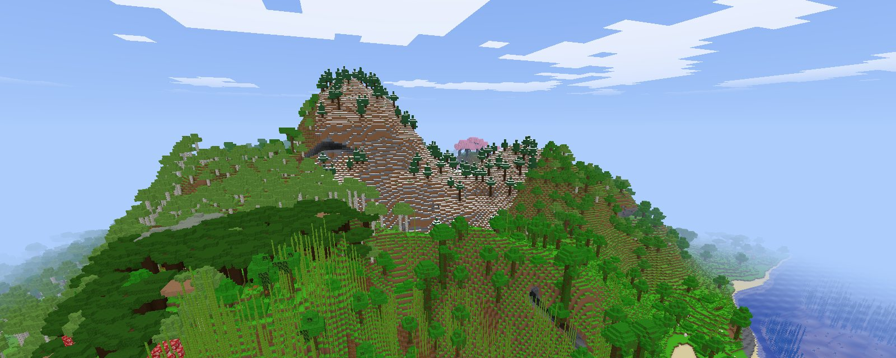

# ⛏️ VoxelCraft

### The block game you love, rebuilt from scratch in Rust.

**Punch a tree. Survive the night. Find the ancient city. Slay the dragon.**<br>
Free, open source and about 7 MB. No launcher, no account, no ads.

<p>
  <a href="https://github.com/BrendanH18/VoxelCraft/releases/latest"></a>
  &nbsp;
  <a href="https://github.com/BrendanH18/VoxelCraft/releases/latest"></a>
</p>

<p>
  <a href="https://github.com/BrendanH18/VoxelCraft/releases/latest"></a>
  <a href="https://github.com/BrendanH18/VoxelCraft/actions/workflows/ci.yml"></a>
  <a href="https://github.com/BrendanH18/VoxelCraft/stargazers"></a>
  <a href="https://wgpu.rs"></a>
  <a href="#license"></a>
</p>

<a href="#the-world">The world</a> ·
<a href="#install">Install</a> ·
<a href="#play-together">Play together</a> ·
<a href="#under-the-hood">Under the hood</a> ·
<a href="#build-from-source">Build</a> ·
<a href="#whats-next">What's next</a>

</div>

---

You wake up on a beach with nothing. There's a forest behind you, a mountain
past that, and the sun is already going down.

**VoxelCraft** is a survival sandbox that plays like Minecraft Java Edition,
written from the ground up in Rust by people who love that game. It's not a
mod, a launcher or a reskin: the world generator, renderer, mobs, menus,
textures, sounds and music are all original code. It aims to feel exactly
right: Java Edition 26.3 is the reference, so recipes, loot, mob behaviour
and controls match what your hands already know.

It runs at hundreds of frames per second on a laptop, and the whole game
downloads in less time than it takes to read this paragraph.

> [!TIP]
> **v0.14 is on its way.** It bundles three releases' worth of content: the
> ancient city and the warden, trial chambers, villages built from
> templates, bastions, more than twenty new mobs and much more. Everything below is in
> the source today. [Build it](#build-from-source) to play now, or grab the
> current download and the game will offer v0.14 as soon as it ships.

<a id="the-world"></a>

## 🌍 A world worth getting lost in

<table>
  <tr>
    <td width="50%" valign="top">
      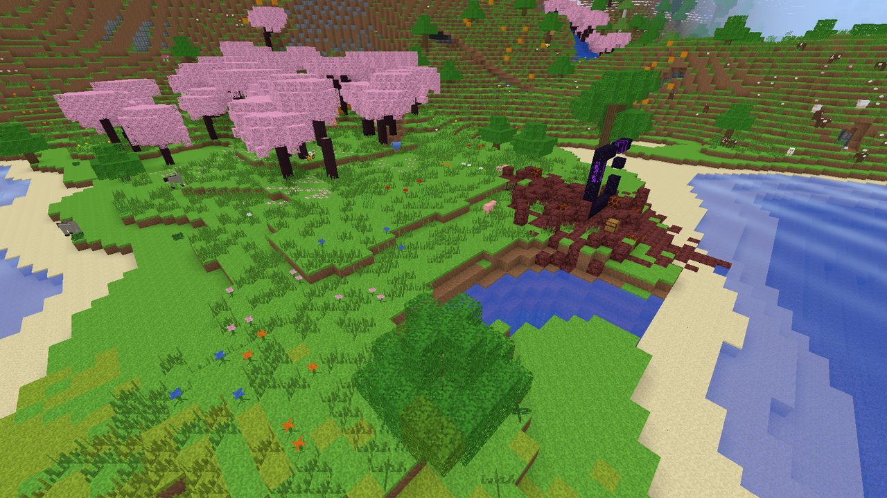<br>
      <h3>🌸 Every biome, every seed</h3>
      54 Overworld biomes, from cherry groves and mangrove swamps to jagged
      peaks, badlands and frozen oceans, each with its own trees, flowers
      and weather. Dig down and you'll find cheese caves, lush caves and
      dripstone caverns all the way to y=-64.
    </td>
    <td width="50%" valign="top">
      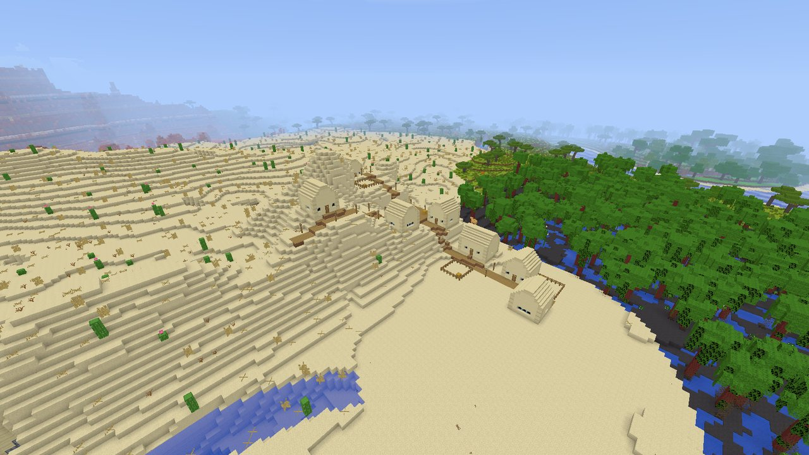<br>
      <h3>🏘️ Villages and ruins</h3>
      Villages that settle into the land around them, pillager outposts,
      desert pyramids, jungle temples, shipwrecks, ocean ruins, trail ruins
      and buried treasure. Every chest uses Java's loot tables, so the
      treasure is worth the trip.
    </td>
  </tr>
  <tr>
    <td width="50%" valign="top">
      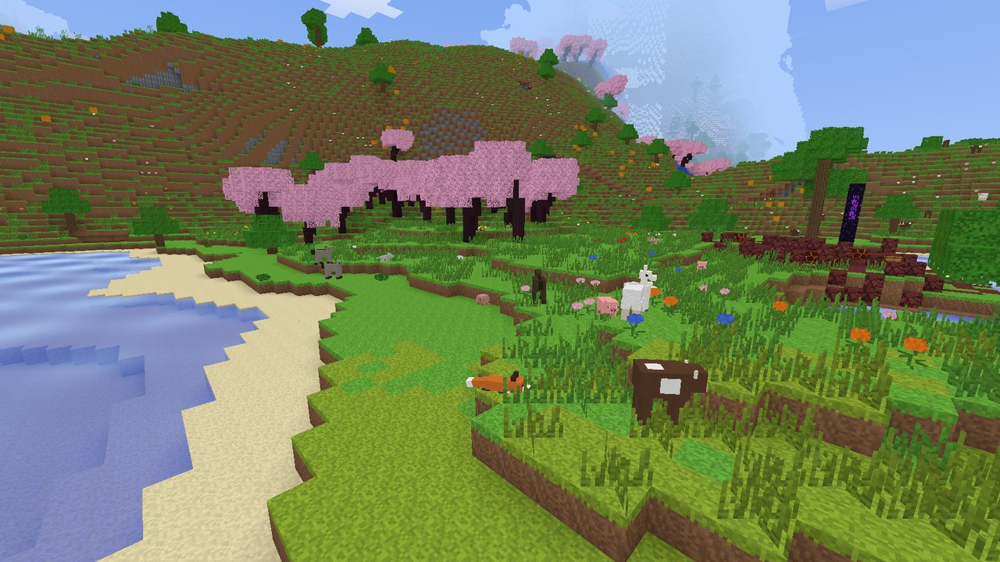<br>
      <h3>🦊 Creatures great and small</h3>
      More than 75 kinds of mob. Herd sheep, tame wolves and cats, saddle
      horses and camels, befriend an allay, hatch a sniffer, and watch
      foxes, frogs, armadillos, pandas and bees go about their day.
    </td>
    <td width="50%" valign="top">
      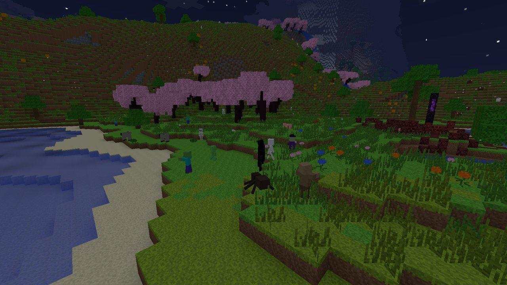<br>
      <h3>🌙 …and things that go bump in the night</h3>
      When the sun sets, zombies, skeletons, creepers, spiders, endermen
      and witches come out to play. Build a shelter, light it up, or hold
      the line with a shield and a sword.
    </td>
  </tr>
  <tr>
    <td width="50%" valign="top">
      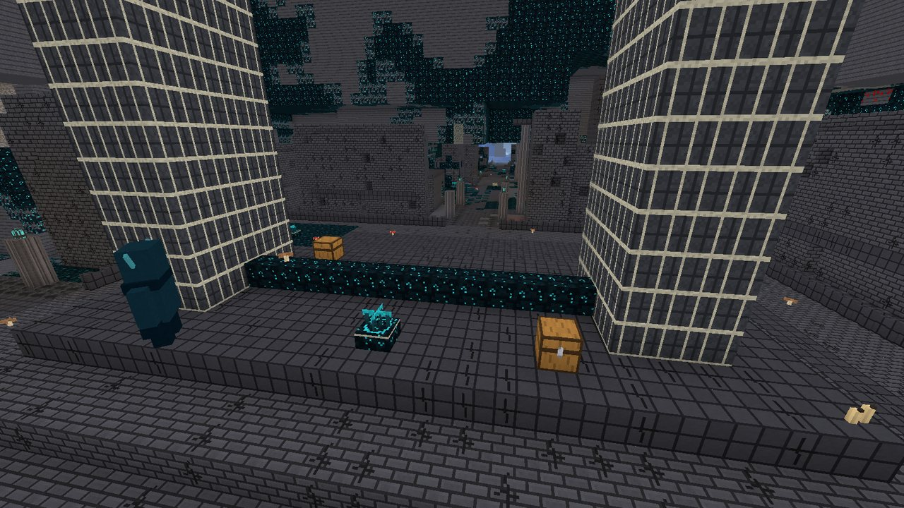<br>
      <h3>🕯️ The deep dark</h3>
      Far below the surface, ancient cities sleep under a blanket of sculk.
      Sneak past the shriekers for the loot. Wake the warden and, well,
      good luck.
    </td>
    <td width="50%" valign="top">
      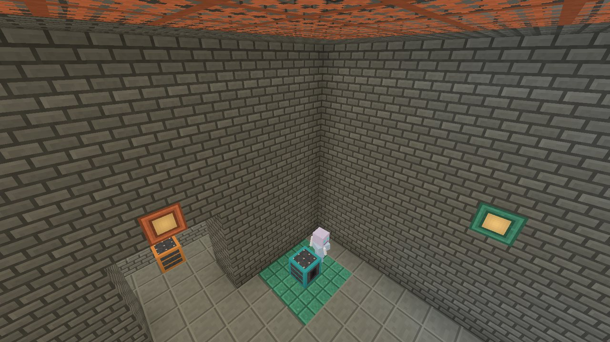<br>
      <h3>⚔️ Trial chambers</h3>
      Copper-and-tuff dungeons full of trial spawners, breezes, bogged and
      vaults. Clear them for the heavy core and forge a mace, or pick up a
      trident, a spear and the rest of the modern arsenal.
    </td>
  </tr>
  <tr>
    <td width="50%" valign="top">
      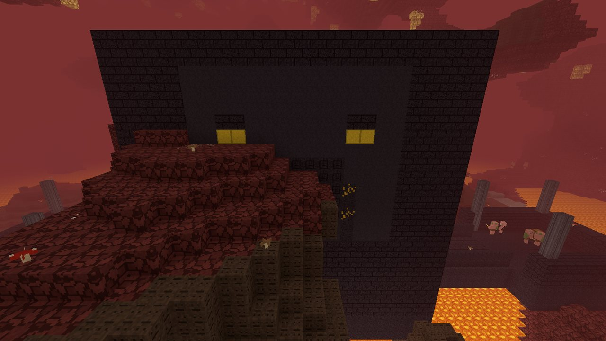<br>
      <h3>🔥 The Nether and the End</h3>
      Light a portal and cross five Nether biomes to fortresses and bastion
      remnants guarded by piglins, hoglins, blazes and ghasts. Then follow
      your eyes of ender to a stronghold, the End and its dragon.
    </td>
    <td width="50%" valign="top">
      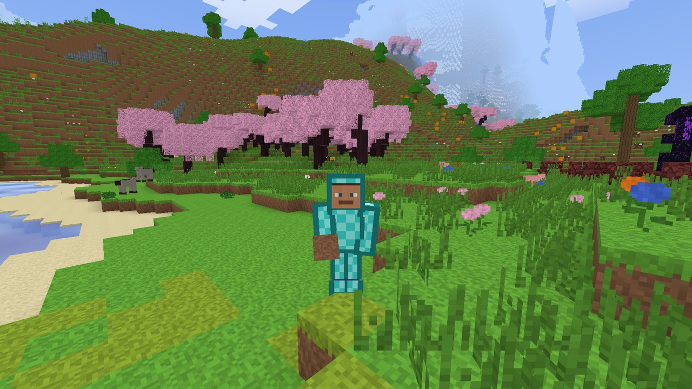<br>
      <h3>💎 Gear up</h3>
      Mine your way to diamond and netherite. Brew potions, enchant your
      gear, repair it on an anvil and upgrade it at the smithing table.
      Press <kbd>F5</kbd> and admire the result.
    </td>
  </tr>
</table>

<p align="center">
  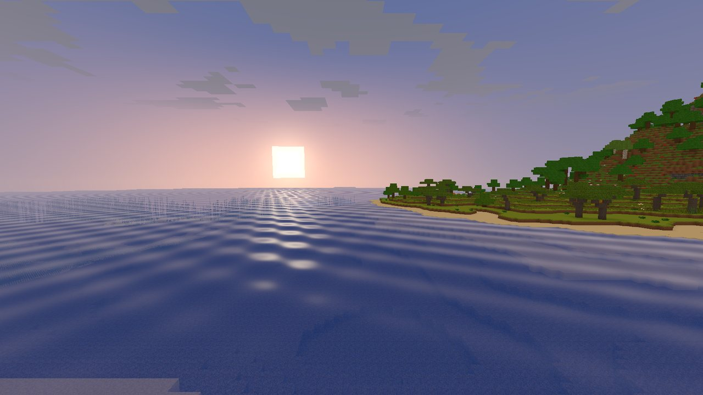<br>
  <sub>Every texture, sound and song you'll see and hear is generated by code. None of it comes from Minecraft.</sub>
</p>

### Everything you'd expect

- 🧱 **Over 1,100 of Java's blocks**: sixteen colours of wool, glass,
  concrete and terracotta, twelve wood types, copper that weathers,
  stairs, slabs, walls, doors and signs.
- 🔨 **Hundreds of Java recipes** and a recipe book that shows every layout,
  so you won't need a wiki open in another window.
- 🌾 **Farming and food**: wheat, carrots, potatoes, melons, pumpkins and
  beetroot, bees and honey, breeding, fishing, cooking and composting.
- 💧 **A world that moves**: flowing water and lava, falling sand, fire that
  spreads, TNT, rain, thunder and lightning, and redstone that powers doors,
  lamps and pistons.
- 🎮 **Five game modes**: Survival, Creative, Hardcore (one life, no second
  chances), Adventure and Spectator, at the difficulty you choose.
- 🎵 **An original soundtrack** with positional audio, and a separate volume
  for each sound category.

<a id="install"></a>

## 🚀 Install

Grab the latest version from
[**Releases**](https://github.com/BrendanH18/VoxelCraft/releases/latest):

| Platform | File | How |
| --- | --- | --- |
| **Windows 10/11** (x64) | `…-windows-x64-Setup.exe` | Run the setup wizard. |
| **macOS 13+** (Apple Silicon) | `…-macos-apple-silicon.dmg` | Open it and drag VoxelCraft into Applications. |
| **Linux, Intel Mac** | — | [Build from source](#build-from-source) with Cargo. |

> [!NOTE]
> The builds aren't signed by a verified publisher yet, so Windows or macOS
> may warn you the first time you open the game. Each download includes
> notes on how to continue, and the [release guide](docs/releases.md) has
> the details.

**It keeps itself up to date.** The game offers each new release on the
title screen and installs it with **Update and Restart**, backing up your
worlds first. Worlds and settings live in a
[separate data folder](docs/releases.md#player-data-and-old-saves), so they
carry over. See [Updating VoxelCraft](docs/updates.md).

<a id="play-together"></a>

## 👥 Play together

<table>
  <tr>
    <td width="55%">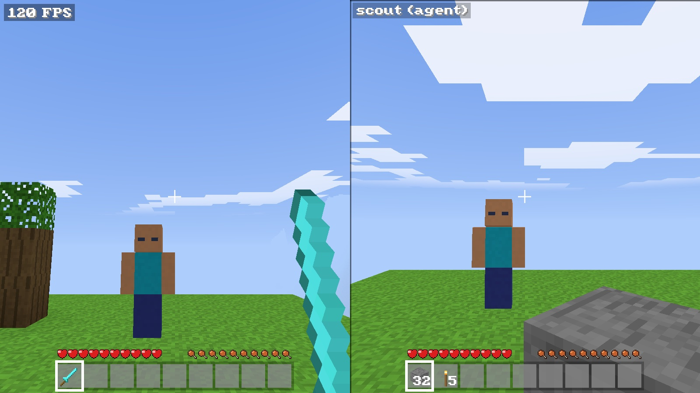</td>
    <td width="45%" valign="top">
      <h3>🛋️ Couch co-op</h3>
      Plug in a gamepad and press <strong>Start</strong>. A friend drops in
      beside you with their own split-screen view, hotbar, health and
      hunger. Up to three controllers can join the keyboard player.
      <h3>🌐 Open to LAN</h3>
      Load a world, press <strong>Esc → Open to LAN</strong> and choose
      <strong>Start LAN World</strong>. Friends on your network find it
      under <strong>Multiplayer</strong>, with chat, a player list and
      optional PvP.
    </td>
  </tr>
</table>

**Bring your bots.** Host a world with `--agent-listen 127.0.0.1:4242` and
up to eight command-line players (scripts, bots or AI agents) can move, mine,
build, craft and fight through the `voxelcraft-agent` tool. Mobs treat them
like anyone else. See [LAN play](docs/lan.md) and
[hosted agents](docs/agents.md).

<a id="under-the-hood"></a>

## ⚡ Under the hood

VoxelCraft is built for speed. Chunks generate and light in parallel on a
worker pool, greedy meshing packs faces into 12-byte quads that the vertex
shader unpacks, and every chunk shares one pooled GPU mesh arena. Smooth
lighting, ambient occlusion, reflective water, positional audio and the
music are all made by code at runtime.

Measured on 26 October 2026 on an **Apple M5** MacBook Pro running on
battery: a release build rendering a 360° sweep at 1600 × 900, with the GPU
synchronised every frame (median of three runs):

| View distance | Frame time | Frame rate |
| :-- | --: | --: |
| 256 blocks (`--rd 8`) | 2.73 ms | **~366 fps** |
| 512 blocks (`--rd 16`) | 7.53 ms | **~133 fps** |

Your numbers will vary with hardware, power settings and scene. Run the same
sweep yourself with `cargo run --release -- --bench-render --rd 8`.

**Faithful by design, and checked.** The parts of the game that are data
(recipes, loot tables, trades, mob stats, damage types, enchantments, status
effects) are compared against facts extracted from the Java 26.3 reference by
tools in [`tools/`](tools), and the test suite fails when they drift. The
[roadmap](docs/roadmap.md) lists every known difference. The
[architecture notes](docs/architecture.md) explain how it all fits together.

<a id="build-from-source"></a>

## 🛠️ Build from source

You'll need a recent stable **Rust** toolchain (edition 2024) and a GPU that
wgpu supports through Metal, Vulkan or DirectX 12. CI builds on macOS, Linux
and Windows.

```sh
# Debian/Ubuntu only: audio and gamepad headers
sudo apt-get install libasound2-dev libudev-dev libfontconfig1-dev libfreetype6-dev pkg-config

git clone https://github.com/BrendanH18/VoxelCraft.git
cd VoxelCraft
cargo run --release
```

Jump straight into a world, skipping the title screen:

```sh
cargo run --release -- --creative --world sandbox --seed 42
```

Most of the screenshots on this page come from seed 42, so go and find them.

<details>
<summary><strong>⚙️ Common command-line options</strong></summary>
<br>

| Option | What it does |
| --- | --- |
| `--creative` / `--survival` | Choose a game mode |
| `--world <name>` | Load or create `saves/<name>`, skipping the title screen (a world saved by a newer version asks first) |
| `--new` | Start the selected world fresh, replacing it when it saves |
| `--data-dir <dir>` | Use a separate folder for saves, options and logs |
| `--seed <n>` | Set the seed for a new world |
| `--rd <chunks>` | Render distance in 32-block chunks (default `8` = 256 blocks) |
| `--no-vsync` | Uncap the frame rate |
| `--graphics classic/enhanced` | Original look, or directional sunlight and reflective animated water |
| `--mute` / `--volume <0..1>` | Set audio at startup |
| `--agent-listen <IP:PORT>` | Host command-line players in this world ([details](docs/agents.md)) |
| `--split-screen <names>` | Show up to three hosted players in split-screen |
| `--help` | List every option, including benchmarks, screenshots and debug flags |

</details>

<a id="whats-next"></a>

## 🧭 What's next

VoxelCraft is heading for a 1.0 that matches modern Java single-player
survival, one themed release at a time:

**v0.13** terrain ✅ → **v0.14** structures, wildlife, the deep dark and
trial chambers (next) → **v0.15** villages and raids → **v0.16** the End and
the Wither → **v0.17** redstone and automation → **v0.18** polish and
performance → **1.0**. Multiplayer grows after 1.0.

The [roadmap](docs/roadmap.md) has the scope of each release, how it's
checked and every known difference from Java.

## 📚 Documentation

The [gameplay guide](docs/gameplay.md) covers controls, survival rules, mobs
and recipes, and the [documentation index](docs/README.md) lists everything
else, from [LAN play](docs/lan.md) to the
[architecture](docs/architecture.md) and
[development guide](docs/development.md).

## 🤝 Contributing

Found a bug, have an idea, or want to add a block? Come on in.
[CONTRIBUTING.md](CONTRIBUTING.md) covers setup, the checks to run and what
to put in a bug report.

<div align="center">

### ⭐ Enjoying VoxelCraft?

**[Star the repo](https://github.com/BrendanH18/VoxelCraft)** to follow
along. It's the easiest way to help more players find it.

</div>

## License

Licensed under [MIT](LICENSE-MIT) or [Apache 2.0](LICENSE-APACHE), at your
option.

Unless you explicitly state otherwise, any contribution intentionally
submitted for inclusion in the work by you, as defined in the Apache-2.0
license, shall be dual licensed as above, without any additional terms or
conditions.

<sub>VoxelCraft is an independent fan project, not affiliated with or endorsed
by Mojang Studios or Microsoft. Minecraft is a trademark of Mojang Studios.
VoxelCraft contains no Minecraft code or assets.</sub>
