<div align="center">

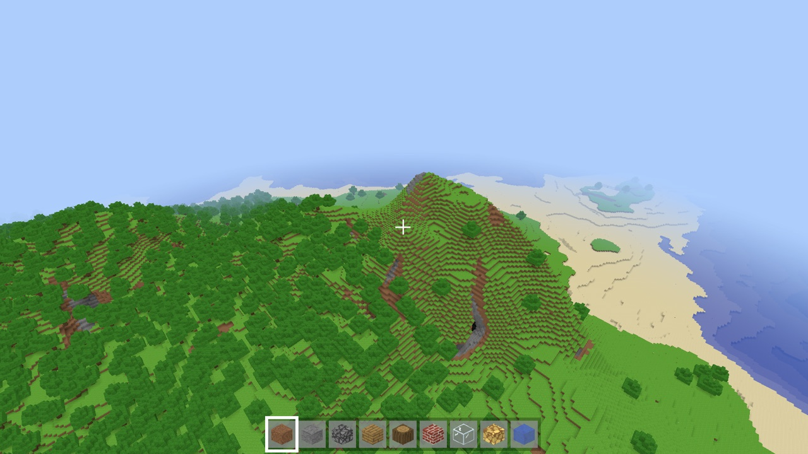

# ⛏️ VoxelCraft

### Punch a tree. Build a house. Slay the dragon.<br>The block game you know, rebuilt from scratch in Rust, in a 6 MB download.

<p>
  <a href="https://github.com/BrendanH18/VoxelCraft/releases/latest"></a>
  &nbsp;
  <a href="https://github.com/BrendanH18/VoxelCraft/releases/latest"></a>
</p>

<p>
  <a href="https://github.com/BrendanH18/VoxelCraft/releases/latest"></a>
  <a href="https://github.com/BrendanH18/VoxelCraft/actions/workflows/ci.yml"></a>
  <a href="https://wgpu.rs"></a>
  <a href="#license"></a>
</p>

<a href="#why-voxelcraft">Why play</a> ·
<a href="#tour">Tour</a> ·
<a href="#install">Install</a> ·
<a href="#first-night">First night</a> ·
<a href="#play-together">Play together</a> ·
<a href="#performance">Performance</a> ·
<a href="#build-from-source">Build</a> ·
<a href="docs/roadmap.md">Roadmap</a>

</div>

---

VoxelCraft is a free, open-source survival sandbox that plays like Minecraft
Java Edition. Start in a field with nothing, work your way up to diamond,
light a portal to the Nether, track down a stronghold, and watch the credits
roll after the Ender Dragon falls. Nearly every texture, sound and song is
generated by code, and none of it comes from Minecraft.

<a id="why-voxelcraft"></a>

## 💎 Why play VoxelCraft

<table>
  <tr>
    <td width="33%" valign="top">
      <h3>🏆 The whole journey</h3>
      Survival from the first tree to the credits: 53 biomes, 54 kinds of
      mob, villages to trade with, three dimensions and the Ender Dragon at
      the end.
    </td>
    <td width="33%" valign="top">
      <h3>⚡ Small and fast</h3>
      A 6 MB installer. No launcher, no account, no sign-in. It draws a
      256-block view at over 300 fps on an Apple M5 laptop (see
      <a href="#performance">performance</a>).
    </td>
    <td width="33%" valign="top">
      <h3>🎯 Faithful to Java</h3>
      Java Edition 26.3 is the reference. Recipes, loot tables, mobs, menus
      and key binds are built to match it, and the
      <a href="docs/roadmap.md">roadmap</a> tracks what still differs.
    </td>
  </tr>
  <tr>
    <td width="33%" valign="top">
      <h3>🔄 Always improving</h3>
      Ten releases since 1 October 2026. Installed copies offer each new
      version on the title screen, back up your worlds and update
      themselves.
    </td>
    <td width="33%" valign="top">
      <h3>🎮 Couch co-op and LAN</h3>
      Plug in a controller for split-screen with up to four players, or open
      your world to friends on the same network.
    </td>
    <td width="33%" valign="top">
      <h3>🦀 Free and open</h3>
      MIT or Apache 2.0, written from scratch in Rust and wgpu. Read it, mod
      it, and send a pull request.
    </td>
  </tr>
</table>

<a id="tour"></a>

## 🗺️ A quick tour

<table>
  <tr>
    <td width="50%" valign="top">
      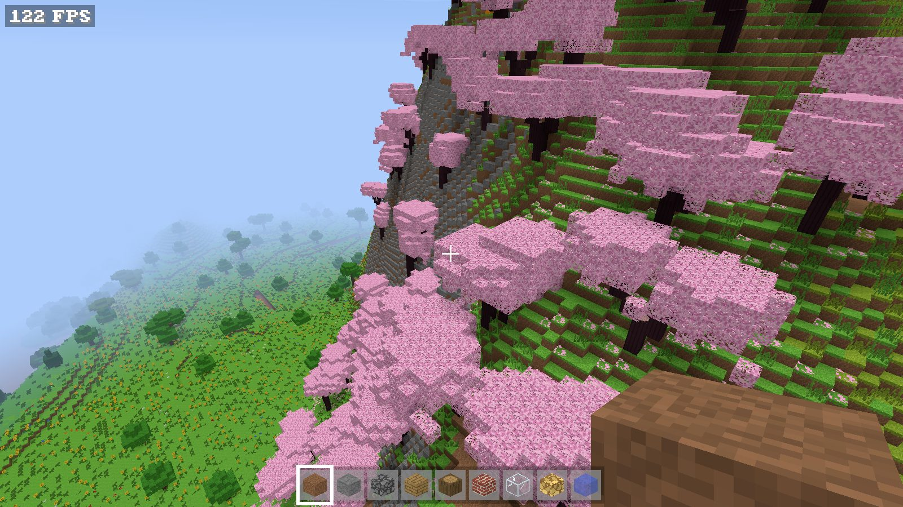<br>
      <h3>🌍 A world worth exploring</h3>
      Cherry groves, mangrove swamps, bamboo jungles, pale gardens, jagged
      peaks, coral reefs and frozen oceans, each with its own trees, flowers
      and ground cover. Below them lie cheese caves, lush caves and dripstone
      caverns down to y=-64.
    </td>
    <td width="50%" valign="top">
      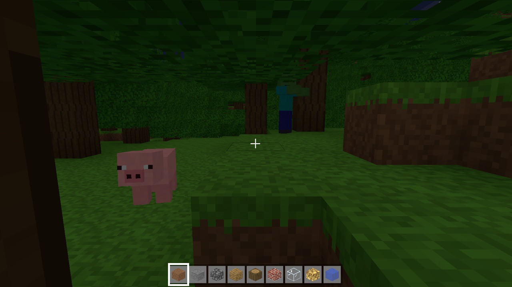<br>
      <h3>🌙 Company after dark</h3>
      Herds wander by day. At night come zombies, skeletons, creepers,
      spiders and Endermen. The seas hold dolphins, axolotls and guardians;
      the Nether adds blazes, ghasts, piglins, hoglins and striders.
    </td>
  </tr>
  <tr>
    <td width="50%" valign="top">
      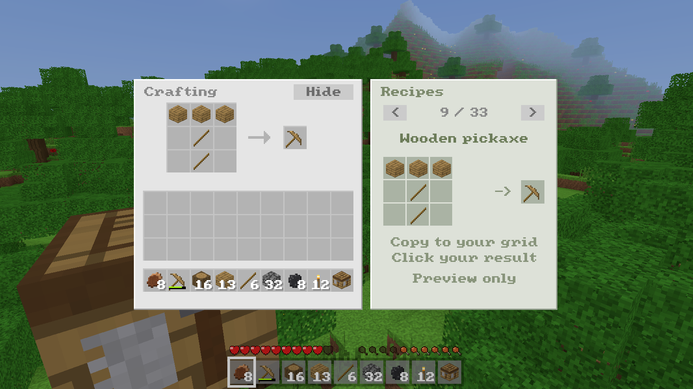<br>
      <h3>🔨 Craft your way up</h3>
      Tools and armour up to netherite, plus bows, torches, beds and chests. The recipe book shows each layout, so you don't need
      a wiki.
    </td>
    <td width="50%" valign="top">
      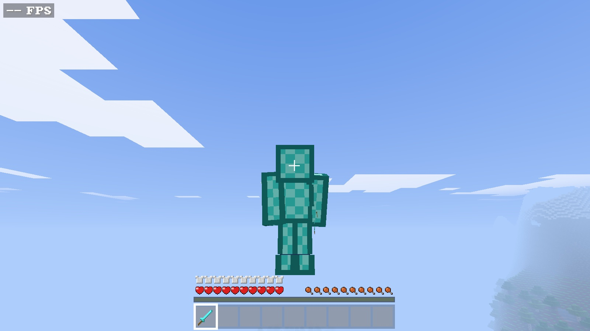<br>
      <h3>✨ Brew, enchant, upgrade</h3>
      Brew potions, enchant gear, repair it at an anvil and take diamond to
      netherite at a smithing table. Press <kbd>F5</kbd> to admire the
      result.
    </td>
  </tr>
  <tr>
    <td width="50%" valign="top">
      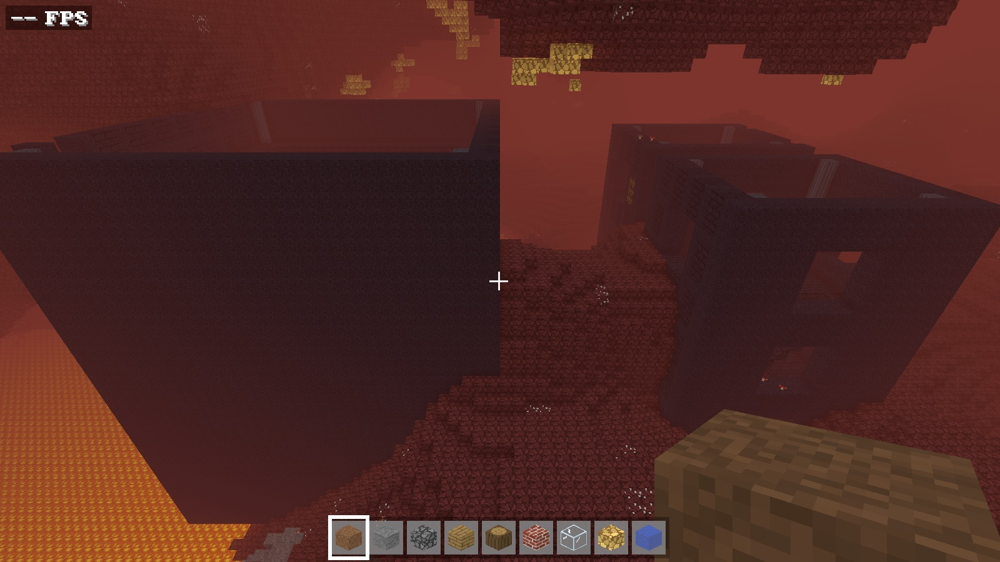<br>
      <h3>🔥 Three dimensions</h3>
      Light an obsidian portal and cross lava seas to fortresses and bastion
      remnants. Then follow your eyes of ender to the End and its dragon.
    </td>
    <td width="50%" valign="top">
      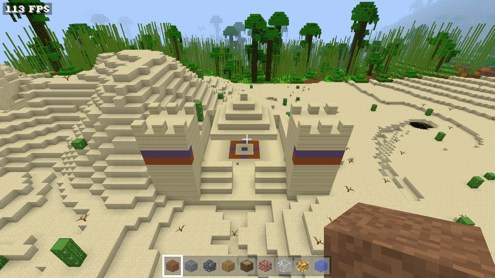<br>
      <h3>🏛️ Ruins and treasure</h3>
      Raid desert pyramids, jungle temples, shipwrecks, ocean ruins and
      pillager outposts, trade with villagers, or brave an ocean monument for
      its gold.
    </td>
  </tr>
  <tr>
    <td width="50%" valign="top">
      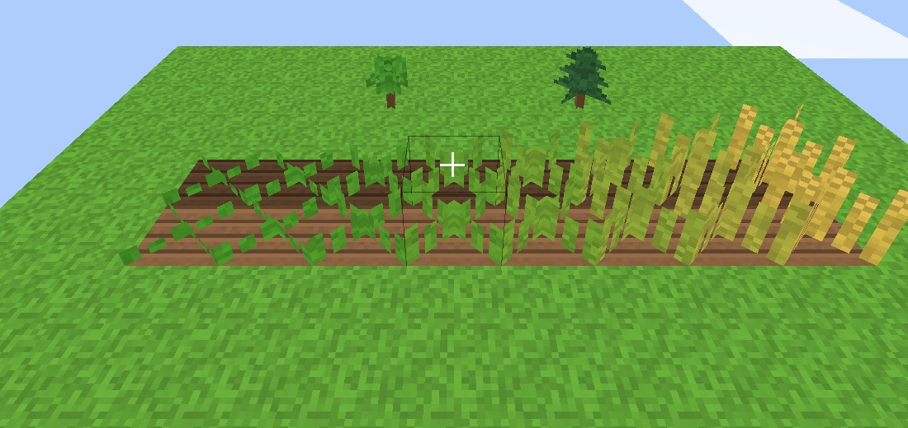<br>
      <h3>🌾 Settle down</h3>
      Till soil, sow seeds and bake bread. Saplings grow into trees, a bed
      skips the night, and animals breed, raise young and lay eggs.
    </td>
    <td width="50%" valign="top">
      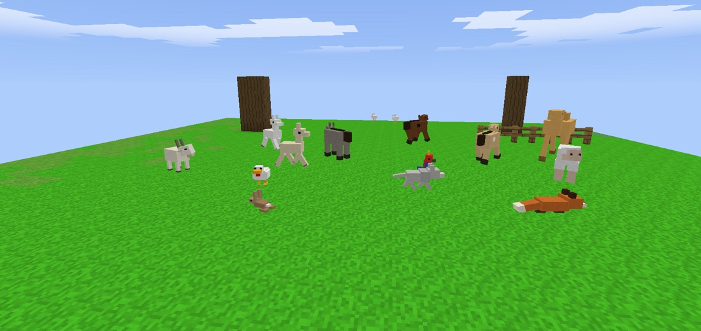<br>
      <h3>🐴 Tame and ride</h3>
      Tame horses, wolves, cats and parrots, saddle pigs and camels, pack
      llamas with chests, sail boats, and name your favourites.
    </td>
  </tr>
  <tr>
    <td width="50%" valign="top">
      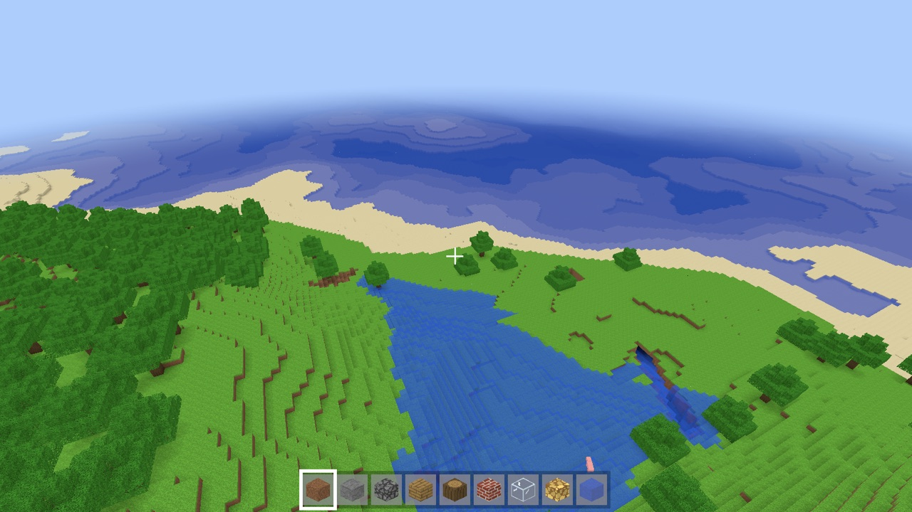<br>
      <h3>💧 A world that moves</h3>
      Water and lava flow, sand falls, fire spreads, TNT blows holes in the
      hills, redstone powers doors and lamps, and rain rolls in under
      drifting clouds.
    </td>
    <td width="50%" valign="top">
      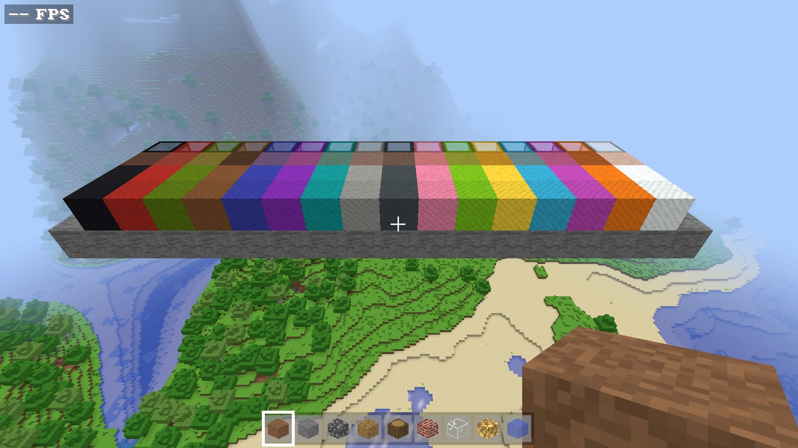<br>
      <h3>🎨 Build anything</h3>
      Sixteen dye colours across wool, glass, terracotta and concrete, twelve
      wood types, and stairs, slabs, fences, doors and ladders to shape them.
    </td>
  </tr>
</table>

<details>
<summary><strong>📸 More screenshots</strong></summary>
<br>
<table>
  <tr>
    <td width="50%">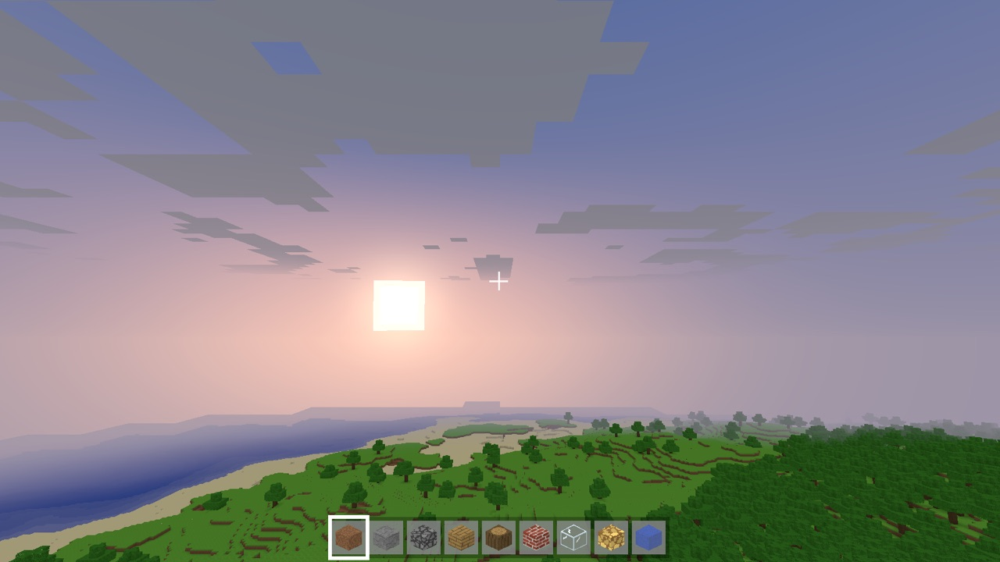<br><strong>Golden hour.</strong> A square sun sets over the coast.</td>
    <td width="50%">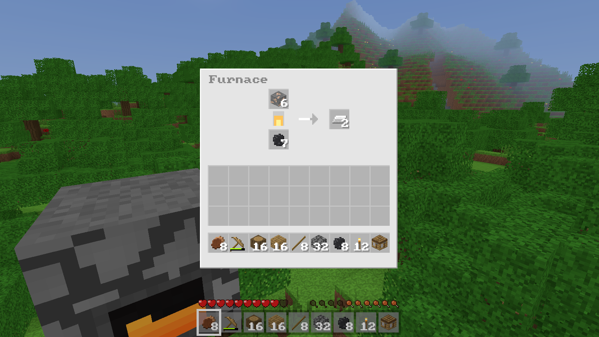<br><strong>Smelt and cook.</strong> Turn ore into ingots and raw food into meals.</td>
  </tr>
  <tr>
    <td width="50%">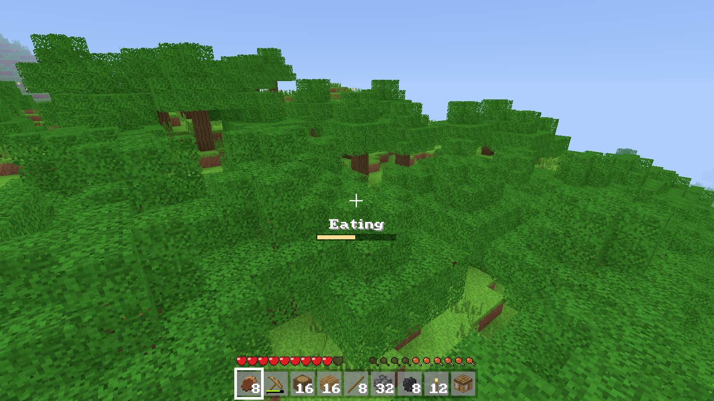<br><strong>A bite to eat.</strong> Hold right-click with food and watch the bite progress.</td>
    <td width="50%">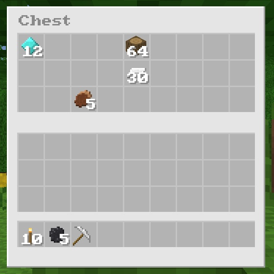<br><strong>Stash it.</strong> Chests hold 27 stacks; shift-click moves whole stacks.</td>
  </tr>
  <tr>
    <td width="50%">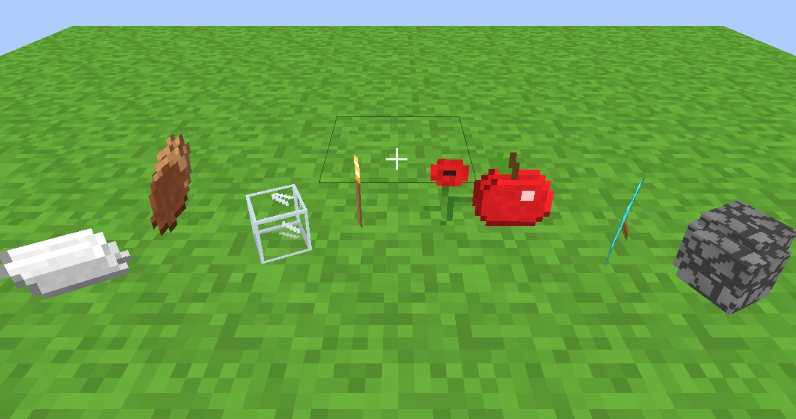<br><strong>Pick it up.</strong> Blocks and loot drop as spinning items.</td>
    <td width="50%">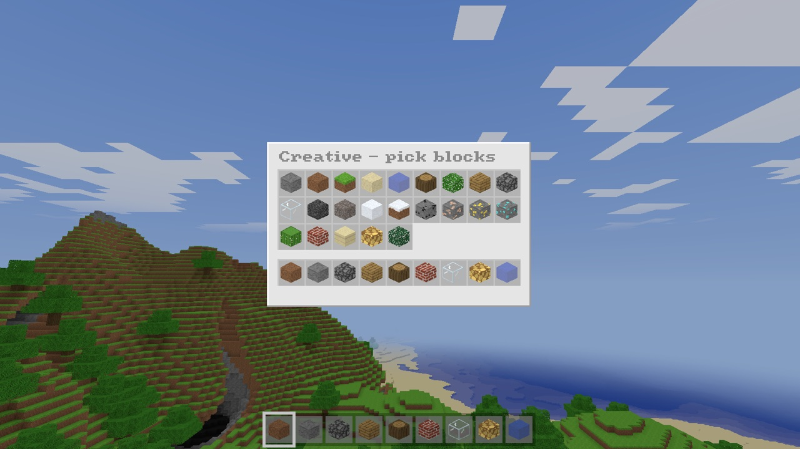<br><strong>Go creative.</strong> Every block at your fingertips, and flight.</td>
  </tr>
  <tr>
    <td width="50%">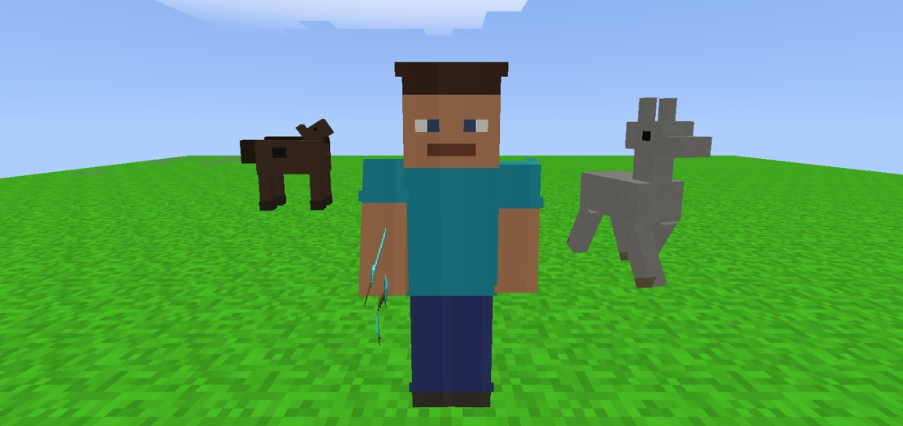<br><strong>Open to LAN.</strong> A friend's view of your world from across the room.</td>
    <td width="50%">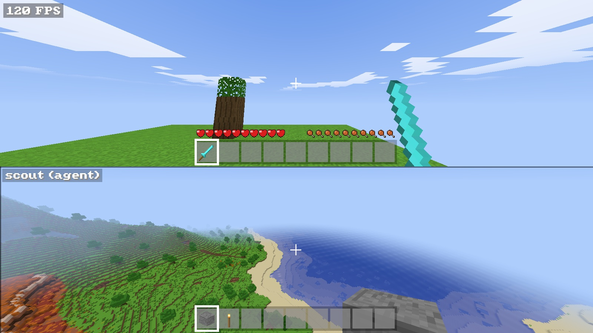<br><strong>Miles apart.</strong> Each split-screen view streams its own world at full distance.</td>
  </tr>
</table>
</details>

### Pick your challenge

| Mode | What it's like |
| --- | --- |
| 🛠️ **Creative** | Unlimited blocks, flight, no danger. Just build. |
| ⚔️ **Survival** | Health, hunger, timed mining, experience and loot, at the difficulty you choose. |
| 💀 **Hardcore** | Survival on hard with one life. Die and you're a spectator for good. |
| 🧭 **Adventure** / 👻 **Spectator** | Explore without breaking things, or float through walls and watch. |

<a id="install"></a>

## 🚀 Install

Download the latest version from
[**Releases**](https://github.com/BrendanH18/VoxelCraft/releases/latest):

| Platform | File | How |
| --- | --- | --- |
| **Windows 10/11** (x64) | `…-windows-x64-Setup.exe` | Run the setup wizard. |
| **macOS 13+** (Apple Silicon) | `…-macos-apple-silicon.dmg` | Open it and drag VoxelCraft into Applications. |
| **Linux, Intel Mac** | — | [Build from source](#build-from-source) with Cargo. |

> [!NOTE]
> The builds aren't signed by a verified publisher yet, so Windows or macOS
> may warn you the first time you open the game. The installation notes in
> each download explain how to continue. See the
> [release guide](docs/releases.md) for details.

**Updates are automatic.** From v0.10 onward, a copy installed from these
downloads offers each new release on the title screen and installs it with
**Update and Restart**, backing up your worlds first. On v0.9 or earlier, install the latest version by hand once, over the
old one. Your worlds and settings live in a
[separate data folder](docs/releases.md#player-data-and-old-saves) and carry
over. Older versions can't open upgraded worlds, so keep a backup of any world
you care about. See [Updating VoxelCraft](docs/updates.md).

<a id="first-night"></a>

## 🌅 Your first night

From the title screen, choose **Singleplayer**, then **Create New World**.
Name it and pick a game mode and difficulty; the **World** tab takes an
optional seed. Worlds autosave every two minutes.

Click the window to grab the mouse. <kbd>W</kbd><kbd>A</kbd><kbd>S</kbd><kbd>D</kbd>
moves, the mouse looks, <kbd>Space</kbd> jumps, **left click** mines or
fights, **right click** places or uses, and <kbd>E</kbd> opens your inventory.

The sun is already moving. Here's how to be ready when it sets:

1. 🌳 **Punch a tree.** Grab a few logs, open your inventory, and turn each
   log into four planks in the 2×2 crafting grid.
2. 🪵 **Make a crafting table** from four planks in a square, and some
   sticks from two planks stacked on top of each other.
3. ⛏️ **Craft a wooden pickaxe** on the table: three planks across the top,
   two sticks down the middle.
4. 🪨 **Mine some stone.** Eight cobblestone in a ring makes a furnace, and
   a stone pickaxe unlocks iron. Gold and diamond need iron or better.
5. 🍖 **Cook dinner.** Ore or raw meat goes on top of the furnace, fuel
   (coal, charcoal, wood or sticks) below. Hold right-click with food to eat.

Stuck on a recipe? Click **Recipes** in any crafting screen to flip through
layouts and copy them into your grid.

> [!WARNING]
> Dying drops everything you were carrying, and dropped items vanish after
> five minutes. Run back for your stuff!

<details>
<summary><strong>🎮 Full controls</strong></summary>
<br>

These are the defaults. Rebind any of them except <kbd>Esc</kbd> under
**Options → Controls → Key Binds**.

| Input | Action |
| --- | --- |
| <kbd>W</kbd> <kbd>A</kbd> <kbd>S</kbd> <kbd>D</kbd> / mouse | Move / look |
| <kbd>Space</kbd> | Jump (double-tap to fly in creative) |
| Left / right click | Mine or attack / place, use or eat |
| Middle click | Pick block |
| <kbd>E</kbd> | Inventory and 2×2 crafting |
| <kbd>1</kbd>–<kbd>9</kbd> or scroll | Select hotbar slot |
| <kbd>Q</kbd> / <kbd>Ctrl</kbd>+<kbd>Q</kbd> | Drop one item / the whole stack |
| <kbd>Shift</kbd> + click | Move a stack, or craft as many as fit |
| Left <kbd>Ctrl</kbd> | Sprint (needs more than three drumsticks of food) |
| Left <kbd>Shift</kbd> | Sneak, so you won't walk off edges (fly down in creative) |
| <kbd>F</kbd> | Swap the held item with your off-hand (hold right click with a shield to block) |
| <kbd>R</kbd> | Toggle flight in creative |
| <kbd>G</kbd> | Switch between survival and creative |
| <kbd>F5</kbd> | First person / third person back / third person front |
| <kbd>[</kbd> / <kbd>]</kbd> | Lower / raise render distance |
| <kbd>T</kbd> / <kbd>/</kbd> | Chat / command console with <kbd>Tab</kbd> completion: `/give`, `/tp`, `/time`, `/weather`, `/gamemode`, `/locate` and more |
| <kbd>Tab</kbd> | Player list |
| <kbd>F1</kbd> / <kbd>F3</kbd> | Hide HUD / debug overlay |
| <kbd>F11</kbd> | Fullscreen |
| <kbd>Esc</kbd> | Pause, options, and **Save and Quit to Title** |

Swim by sprinting in water; you'll crawl automatically through one-block gaps.
The [gameplay guide](docs/gameplay.md) covers survival rules, mobs and every recipe.

</details>

<a id="play-together"></a>

## 👥 Play together

<table>
  <tr>
    <td width="55%">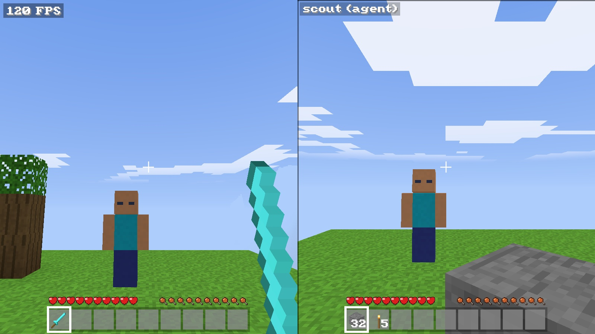</td>
    <td width="45%" valign="top">
      <h3>🎮 Couch co-op</h3>
      Plug in a gamepad and press <strong>Start</strong>. A friend joins
      beside you with their own split-screen view, hotbar, health and hunger.
      Up to three controllers can join the keyboard player.
      <h3>🌐 Open to LAN</h3>
      Load a world, press <strong>Esc → Open to LAN</strong>, pick the
      settings and choose <strong>Start LAN World</strong>. Friends on your
      network find it under <strong>Multiplayer</strong> and share your world,
      with chat, a player list and optional PvP.
    </td>
  </tr>
</table>

You can also script players. Host a world with
`--agent-listen 127.0.0.1:4242`, and up to eight command-line players (bots,
scripts or AI agents) can move, mine, build, craft and fight through the
`voxelcraft-agent` tool. Mobs treat them like anyone else. See
[LAN play](docs/lan.md) and [hosted agents](docs/agents.md).

<a id="performance"></a>

## ⚡ Performance

Chunks generate and light in parallel on a worker pool. Greedy meshing packs
faces into 12-byte quads that the vertex shader unpacks, and every chunk shares
one pooled GPU mesh arena. Smooth lighting, ambient occlusion, reflective
water, positional audio and the soundtrack all come from code.

Measured on 26 October 2026 on an **Apple M5** MacBook Pro running on battery:
a release build rendering a 360° sweep at 1600 × 900, with the GPU synchronised
every frame (median of three runs):

| View distance | Frame time | Frame rate |
| :-- | --: | --: |
| 256 blocks (`--rd 8`) | 2.73 ms | **~366 fps** |
| 512 blocks (`--rd 16`) | 7.53 ms | **~133 fps** |

Your numbers will vary with hardware, power settings and scene. Run the same
sweep with `cargo run --release -- --bench-render --rd 8`. The
[architecture notes](docs/architecture.md) explain the renderer, and the
[development guide](docs/development.md) covers benchmarks and scripted scenes.

<a id="build-from-source"></a>

## 🛠️ Build from source

You'll need a recent stable **Rust** toolchain (edition 2024) and a GPU that
wgpu supports through Metal, Vulkan or DirectX 12. CI builds on macOS, Linux
and Windows.

```sh
# Debian/Ubuntu only: audio and gamepad headers
sudo apt-get install libasound2-dev libudev-dev pkg-config

git clone https://github.com/BrendanH18/VoxelCraft.git
cd VoxelCraft
cargo run --release
```

To skip the title screen, name a world on the command line:

```sh
cargo run --release -- --creative --world sandbox --seed 42
```

<details>
<summary><strong>⚙️ Common command-line options</strong></summary>
<br>

| Option | What it does |
| --- | --- |
| `--creative` / `--survival` | Choose a game mode |
| `--world <name>` | Load or create `saves/<name>`, skipping the title screen (a world saved by a newer version asks first) |
| `--new` | Start the selected world fresh, replacing it when it saves |
| `--data-dir <dir>` | Use a separate folder for saves, options and logs |
| `--seed <n>` | Set the seed for a new world |
| `--rd <chunks>` | Render distance in 32-block chunks (default `8` = 256 blocks) |
| `--no-vsync` | Uncap the frame rate |
| `--graphics classic/enhanced` | Original look, or directional sunlight and reflective animated water |
| `--mute` / `--volume <0..1>` | Set audio at startup |
| `--agent-listen <IP:PORT>` | Host command-line players in this world ([details](docs/agents.md)) |
| `--split-screen <names>` | Show up to three hosted players in split-screen |
| `--help` | List every option, including benchmarks, screenshots and debug flags |

</details>

## 🧭 Where it's headed

VoxelCraft is working toward a 1.0 that matches modern Java single-player
survival closely. Each release completes one area:

**v0.13** terrain → **v0.14** structures (next) → **v0.15** wildlife →
**v0.16** deep dark and trial chambers → **v0.17** villages and raids → **v0.18** the End and the Wither →
**v0.19** redstone and automation → **v0.20** polish and performance →
**1.0**. Multiplayer expansion comes after 1.0.

The [roadmap](docs/roadmap.md) lists the scope of each release, its acceptance
checks and the known differences from Java.

## 📚 Documentation

**Playing:**
[gameplay guide](docs/gameplay.md) ·
[survival items](docs/survival-items.md) ·
[animals](docs/animals.md) ·
[boats and riding](docs/mounts.md) ·
[villages](docs/villages.md) ·
[redstone](docs/redstone.md) ·
[colours and dyes](docs/colors.md) ·
[Nether mobs](docs/nether-mobs.md) ·
[Nether biomes](docs/nether-biomes.md) ·
[bastions](docs/bastions.md) ·
[aquatic mobs](docs/aquatic-mobs.md) ·
[overworld structures](docs/overworld-structures.md) ·
[LAN play](docs/lan.md) ·
[updating](docs/updates.md)

**Building:**
[architecture](docs/architecture.md) ·
[development guide](docs/development.md) ·
[overworld terrain](docs/overworld-terrain.md) ·
[mob parity](docs/mob-parity.md) ·
[player rendering](docs/player-rendering.md) ·
[music](docs/music.md) ·
[particles](docs/particles.md) ·
[hosted agents](docs/agents.md) ·
[releases](docs/releases.md) ·
[documentation index](docs/README.md)

## 🤝 Contributing

Found a bug, have an idea, or want to add a block? You're very welcome here.
[CONTRIBUTING.md](CONTRIBUTING.md) covers setup, the checks to run and what to
include in a bug report.

## License

Licensed under [MIT](LICENSE-MIT) or [Apache 2.0](LICENSE-APACHE), at your option.

Unless you explicitly state otherwise, any contribution intentionally
submitted for inclusion in the work by you, as defined in the Apache-2.0
license, shall be dual licensed as above, without any additional terms or
conditions.

<sub>VoxelCraft is an independent fan project, not affiliated with or endorsed
by Mojang Studios or Microsoft. Minecraft is a trademark of Mojang Studios.
VoxelCraft contains no Minecraft code or assets.</sub>
