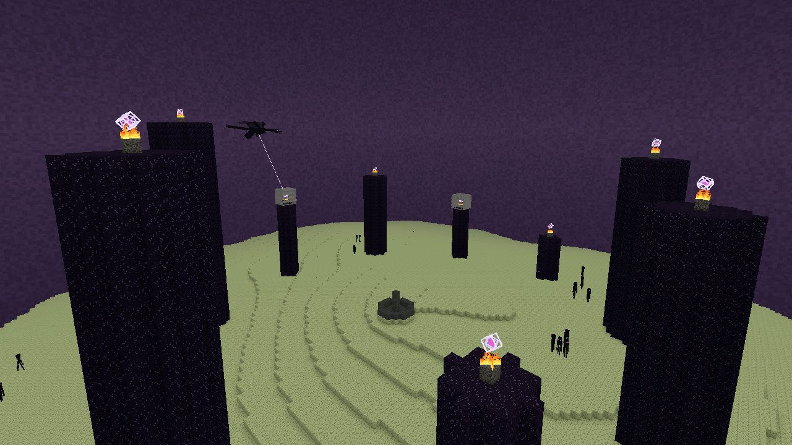

<div align="center">

# ⛏️ VoxelCraft

### Minecraft-style survival, rebuilt from scratch in Rust.

**Punch a tree. Survive the night. Brave the Nether. Slay the dragon.**

<p>
  <a href="https://github.com/BrendanH18/VoxelCraft/releases/latest"></a>
  &nbsp;
  <a href="https://github.com/BrendanH18/VoxelCraft/releases/latest"></a>
</p>

**Free and open source. A 7 MB download. No launcher, no account, no ads.**


<p>
  <a href="https://github.com/BrendanH18/VoxelCraft/releases/latest"></a>
  <a href="https://github.com/BrendanH18/VoxelCraft/actions/workflows/ci.yml"></a>
  <a href="https://wgpu.rs"></a>
  <a href="#license"></a>
</p>

</div>

VoxelCraft is Minecraft Java Edition's single-player survival, rebuilt from
nothing in Rust. It isn't a mod or a launcher: the terrain, renderer, mobs,
menus, textures, sounds and music are all original. Java Edition 26.3 is the
reference, so recipes, loot and mob behaviour match what you already know.

> [!TIP]
> **v0.14 is coming:** ancient cities and the warden, trial chambers,
> rebuilt villages and bastions, and more than twenty new mobs. Cards
> marked 🆕 show it. The current download is v0.13, which offers v0.14 on
> its title screen as soon as it ships, or you can
> [build from source](#build-from-source) and play it today.

## 🗺️ What's out there

<table>
  <tr>
    <td width="50%" valign="top">
      <br>
      <h3>🏘️ Villages and ruins 🆕</h3>
      Villages assembled piece by piece from Java's pools, so no two
      match, plus outposts, pyramids, temples, shipwrecks, ocean ruins,
      trail ruins and buried treasure. Every chest rolls Java's loot
      tables.
    </td>
    <td width="50%" valign="top">
      <br>
      <h3>🐉 The dragon</h3>
      Find a stronghold, fill the portal with eyes of ender and drop into
      the End. Smash the crystals, dodge the breath, and roll the credits.
    </td>
  </tr>
  <tr>
    <td width="50%" valign="top">
      <br>
      <h3>🦊 75 kinds of mob, plus the dragon</h3>
      Tame wolves and cats, saddle horses and camels, befriend an allay,
      hatch a sniffer, and watch foxes, frogs, armadillos, pandas and bees
      go about their day.
    </td>
    <td width="50%" valign="top">
      <br>
      <h3>🌙 Then the sun goes down</h3>
      Zombies, skeletons, creepers, spiders, endermen and witches, with
      Java's spawning rules, so dark places stay dangerous.
    </td>
  </tr>
  <tr>
    <td width="50%" valign="top">
      <br>
      <h3>🕯️ The deep dark 🆕</h3>
      Ancient cities sleep under a blanket of sculk. Sneak past the
      shriekers for the loot. Wake the warden and, well, good luck. Trial
      chambers wait nearby, with breezes, vaults and the mace.
    </td>
    <td width="50%" valign="top">
      <br>
      <h3>🔥 The Nether</h3>
      Five Nether biomes, fortresses and bastion remnants, with piglins
      to barter with, hoglins to hunt, and ghasts and blazes overhead.
    </td>
  </tr>
</table>

### And the rest of it

- 🌍 **54 Overworld biomes**, from cherry groves and mangrove swamps to
  badlands and frozen peaks, with lush caves and dripstone caverns down to
  y=-64. World generation uses its own noise, so a Java seed won't give
  you the same world.
- 🧱 **Over 1,100 of Java's blocks** and hundreds of its recipes, with a
  recipe book that shows every layout.
- ⚗️ **Brewing, enchanting, anvils and smithing**, from wooden tools to
  netherite, plus tridents, maces and spears 🆕.
- 🎮 **All five game modes**, Hardcore included.
- 🎵 **An original soundtrack** and positional audio, made by code at
  runtime.

<p align="center">
  <br>
  <sub>Nearly every texture, sound and song is generated by code. None of it comes from Minecraft.</sub>
</p>

<a id="install"></a>

## 🚀 Install

Download the latest version from
[**Releases**](https://github.com/BrendanH18/VoxelCraft/releases/latest):
the setup wizard for **Windows 10/11** (x64), or the disk image for
**macOS 13+** on Apple Silicon. On Linux or an Intel Mac,
[build from source](#build-from-source).

> [!NOTE]
> The builds aren't signed by a verified publisher yet, so Windows or macOS
> may warn you the first time you open the game. Each download explains how
> to continue; see the [release guide](docs/releases.md).

**It keeps itself up to date.** The game offers each new release on the
title screen and installs it with **Update and Restart**, backing up your
worlds first. See [Updating VoxelCraft](docs/updates.md).

<a id="play-together"></a>

## 👥 Play together

- **Couch co-op.** Plug in a gamepad and press **Start**: a friend joins
  with their own split-screen view, hotbar and health. Up to three
  controllers can join the keyboard player.
- **LAN.** Open any world to your network from the pause menu, and friends
  find it under **Multiplayer**.
- **Bots.** Host with `--agent-listen 127.0.0.1:4242` and up to eight
  command-line players (scripts, bots or AI agents) can move, mine, build
  and fight alongside you. See [LAN play](docs/lan.md) and
  [hosted agents](docs/agents.md).

<a id="under-the-hood"></a>

## ⚡ Under the hood

Chunks generate and light in parallel on a worker pool, greedy meshing packs
faces into 12-byte quads that the vertex shader unpacks, and every chunk
shares one pooled GPU mesh arena.

On an Apple M5 MacBook Pro on battery, at 1600 × 900 (median of three runs,
measured on 26 October 2026, before the v0.14 content):

| View distance | Frame time | Frame rate |
| :-- | --: | --: |
| 256 blocks (`--rd 8`) | 2.73 ms | **~366 fps** |
| 512 blocks (`--rd 16`) | 7.53 ms | **~133 fps** |

Run the same sweep with `cargo run --release -- --bench-render --rd 8`.

**Checked against Java.** Recipes, loot tables, trades, mob stats, damage
types, enchantments and status effects are compared with facts extracted
from the Java 26.3 game files by tools in [`tools/`](tools), and the tests
fail when they drift. The [roadmap](docs/roadmap.md) lists every known
difference.

<a id="build-from-source"></a>

## 🛠️ Build from source

You'll need a recent stable **Rust** toolchain (edition 2024) and a GPU that
wgpu supports through Metal, Vulkan or DirectX 12.

```sh
# Debian/Ubuntu only: audio and gamepad headers
sudo apt-get install libasound2-dev libudev-dev libfontconfig1-dev libfreetype6-dev pkg-config

git clone https://github.com/BrendanH18/VoxelCraft.git
cd VoxelCraft
cargo run --release -- --creative --world sandbox --seed 42
```

Seed 42 is where most of these screenshots were taken. `--help` lists every
option.

<a id="whats-next"></a>

## 🧭 What's next

**v0.14** structures, wildlife, the deep dark and trial chambers (next) →
**v0.15** villages and raids → **v0.16** the End and the Wither →
**v0.17** redstone and automation → **v0.18** polish and performance →
**1.0**, a faithful match for modern Java single-player survival.
Multiplayer grows after that. The [roadmap](docs/roadmap.md) has the
details.

## 🤝 Get involved

Found a bug or want to add a block? Come on in:
[CONTRIBUTING.md](CONTRIBUTING.md) covers setup and checks, the
[gameplay guide](docs/gameplay.md) covers controls and rules, and the
[documentation index](docs/README.md) lists everything else.

<div align="center">

### ⭐ Like where this is going?

**[Star the repo](https://github.com/BrendanH18/VoxelCraft)** to follow
along. It's the easiest way to help more players find it.

</div>

## License

Licensed under [MIT](LICENSE-MIT) or [Apache 2.0](LICENSE-APACHE), at your
option.

Unless you explicitly state otherwise, any contribution intentionally
submitted for inclusion in the work by you, as defined in the Apache-2.0
license, shall be dual licensed as above, without any additional terms or
conditions.

<sub>VoxelCraft is an independent fan project, not affiliated with or endorsed
by Mojang Studios or Microsoft. Minecraft is a trademark of Mojang Studios.
VoxelCraft contains no Minecraft code or assets.</sub>
