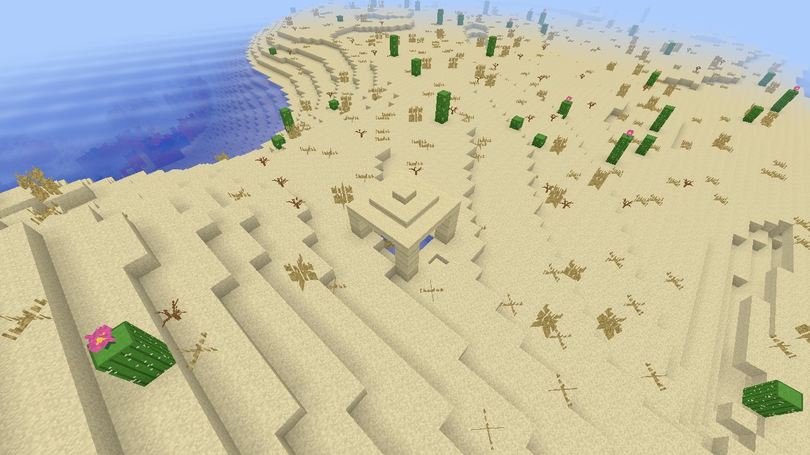
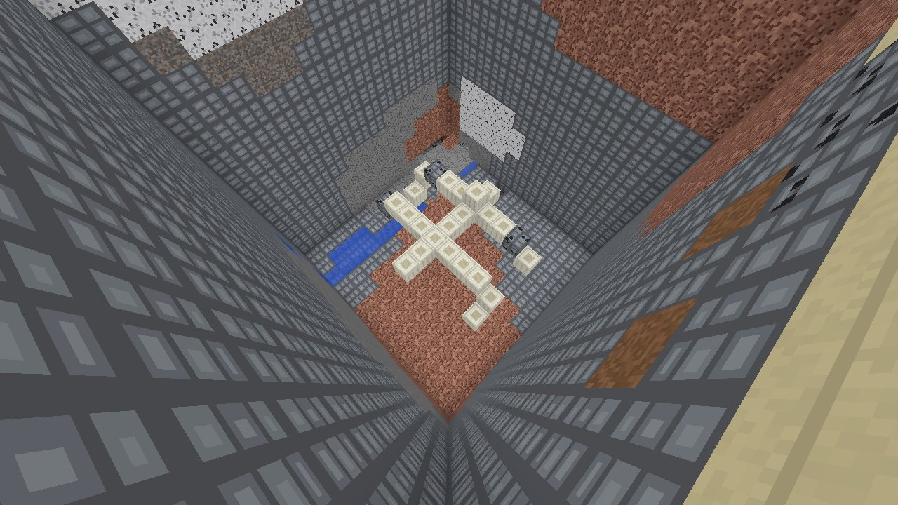
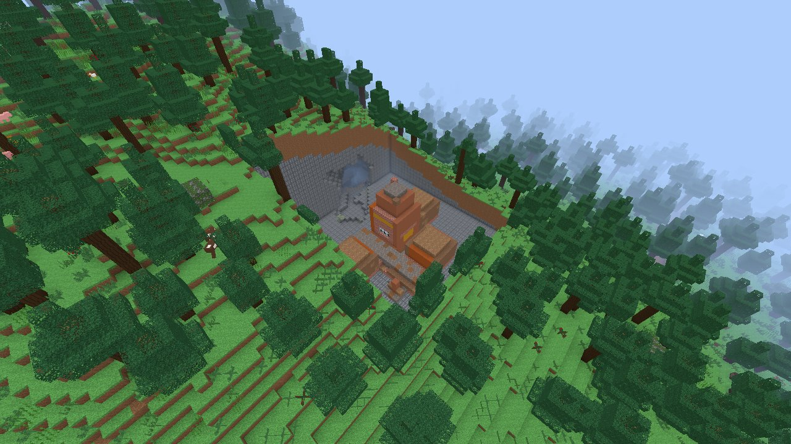

# v0.14 fossils, Nether fossils, desert wells and trail ruins (GEN-05f)

[Roadmap v0.14](../roadmap.md#v014-scope-structures) · [Jigsaw engine](2026-11-03-v0.14-jigsaw-villages.md) · [Development guide](../development.md)

Track 5b, 2026-11-03. Base `b53ac92`, branch `t3/fossils-wells-trail-ruins`. Implementation and agent checks are recorded here;
this is not the owner's ordinary play or a claim of complete Java parity.
For this release the owner explicitly requested Codex implementation
agents, overriding the normal Claude implementation-agent preference.
Everything that changes generated blocks is restricted to generation 3.
No Minecraft template or asset was opened or copied. All geometry is original.

## Allocation and integration

No new block states, items, textures or saved enums. Reserved block states
10496–10623, item IDs 1250–1254 and texture layers 2928–2943 remain unused.
Bone blocks (1631), coal ore (15), deepslate diamond ore (252), sandstone,
slabs, sand, water, mud bricks, packed mud, terracotta, bricks, panes, gravel,
dirt and coarse dirt already existed, with mining, inventory and persistence.

- `relics.rs`: two independent 1/64 fossil rolls and a 1/1000 well roll
  per Java 16-block decoration chunk. Bounded caches hold complete layouts;
  chunks paint only their cells. Protected blocks survive painting.
- `jigsaw/relics.txt`: four spines and four skulls, eight paired ore overlays,
  four smaller Nether forms, and a seven-block-wide roofed well.
- `nether_fossil.rs`: Java random-spread grid (2/1, salt 14357921), random
  x/z within the start chunk, uniform initial height 32–125, descending
  to air over a sturdy block above sea level 32, soul-sand-valley filter,
  random rotation and original template choice. No air cells are painted.
  Generation 3 disables the former procedural decoration fossils;
  generations 1 and 2 retain that path unchanged.
  Single-column exposure checks include these bones before ancient debris,
  matching full chunk painting. `/locate nether_fossil` is also supported.
- `trail_ruins.rs` and `jigsaw/trail_ruins.txt`: random spread 34/8, salt
  83469867; the six exact Java biome-tag members; jigsaw target at the
  first-air surface heightmap (including water) minus 15, layer 0 one block below it
  (`SinglePoolElement` ground-level delta 1); rigid jigsaw assembly at depth 7 and maximum distance 80. Two tower
  bases, a crown, two road sections, a hall, a chamber, a grouped room and
  a marker use all seven Java pool names. Reduced pools retain equal
  weight 1 and the empty fallback. No foundations or clearing above pieces.
  `/locate trail_ruins` and `/locate structure trail_ruins` are available in
  generation 3 Overworlds. Both forms also accept `nether_fossil` in the Nether.
- Shared edits are additive: generator fields and painting hooks, module
  registrations, `/locate`, GEN-07 corpus and benchmark scenes. The sole
  terrain-helper change exposes the existing top-surface block query to
  sibling world modules so wells test actual sand, including steep surfaces.
  Open-sky chunks still paint any structures reaching from higher neighbouring
  terrain. No jigsaw-engine behavior was changed.

The reduced trail pools use the following catalogue sizes (every element
has weight 1; every fallback is `empty`):

| Pool suffix under `trail_ruins/` | Java 26.3 elements | VoxelCraft elements |
| --- | --- | --- |
| `tower` | 5 | 2 |
| `tower/tower_top` | 5 | 1 |
| `tower/additions` | 25 | 1 |
| `roads` | 7 | 2 |
| `buildings` | 15 | 1 |
| `buildings/grouped` | 20 | 1 |
| `decor` | 7 | 1 |

Fossils choose rotation and one of eight shapes, scan the complete rotated
footprint's ocean floor, and place at
`max(min(initial_height, lowest_ocean_floor) - 15 - nextInt(10), -54)`.
The upper initial height is 0–319 inclusive; lower is -64–-8 inclusive.
At most four of eight bounding-box corners may be air/water/lava. Corner
validation uses `Generator::natural_block`, including caves and aquifers,
so it cannot depend on generated neighbours. Bone integrity is 0.9 and
independent overlay integrity is 0.1. The lower overlay substitutes
deepslate diamond ore. Final expected proportions for paired geometry are
81% bone, 10% ore, 9% holes. Painting is clipped to the source Java chunk
expanded by 16 blocks as well as the destination engine chunk.

Wells require desert, a sand surface at the motion-blocking height minus
one, and no air in the 5×2×5 support volume below. The template starts two
blocks below that surface. The two independent archaeological overlays
choose the centre or a cardinal neighbour, at surface minus one and minus
two, and place plain sand without loot (DEF-02).

Trail-ruin house/road processors change gravel to dirt with probability
0.2, then remaining gravel to coarse dirt with probability 0.1 (0.08 of
all gravel), and mud bricks to packed mud with probability 0.1. Tower
crowns have only the archaeological processor. Suspicious gravel and its
loot are deferred; its capped processor has no observable block change
when suspicious gravel becomes gravel, since the replaceable tag contains
only gravel.

## Reference evidence

Behaviour facts were read from the owner's pinned Java 26.3 extraction,
`target/java-ref` in the reference worktree (read-only):

- `data/minecraft/worldgen/placed_feature/fossil_upper.json`,
  `fossil_lower.json`, `desert_well.json`;
- `worldgen/biome/desert.json`, `swamp.json`, `mangrove_swamp.json`
  (the only biomes containing fossil features, and desert alone for wells);
- `worldgen/feature/fossil_coal.json`, `fossil_diamonds.json`,
  `desert_well.json`;
- `worldgen/processor_list/fossil_rot.json`, `fossil_coal.json`,
  `fossil_diamonds.json`, and the three `trail_ruins_*_archaeology.json` files;
- `worldgen/structure/nether_fossil.json`, `trail_ruins.json`;
  `worldgen/structure_set/nether_fossils.json`, `trail_ruins.json`;
- `worldgen/template_pool/trail_ruins/**/*.json` (names, weights,
  fallbacks and processors only), the `has_structure/trail_ruins` biome
  tag and the `trail_ruins_replaceable` block tag;
- `worldgen/noise_settings/nether.json`: generation height 128, sea level
  32. Hence `below_top: 2` is 125, despite the 256-block build height;
- decompiled `FossilFeature.place/countEmptyCorners`,
  `NetherFossilStructure.findGenerationPoint`, `NetherFossilPieces`,
  `JigsawPlacement.addPieces` and `StructurePoolElement.getGroundLevelDelta`.

Placement-grid expectations were independently computed using a Python
48-bit `java.util.Random` implementation, not VoxelCraft's JavaRandom.
For seed 12345, trail-ruin region/start chunk pairs are `(0,0)/(6,17)`,
`(-1,-1)/(-25,-13)`, `(2,-3)/(91,-90)`, `(-17,23)/(-578,791)`.
Nether fossil offsets are always zero because spacing minus separation is 1.

## Checks

Every Cargo command used
`CARGO_TARGET_DIR=/Users/brendanhallas/.t3/worktrees/minecraft_rust/shared-target`.
`build.rs` was touched before checks. Builds used `CARGO_BUILD_JOBS=2` and
tests used `RUST_TEST_THREADS=4` after an initial executable was killed before
its test harness started. Another full run passed all executable tests but
lost its generated `assets.rs` to a concurrent package clean before doc-tests.
Temporary run tools under ignored `target/relics/` therefore snapshot test
executables, the crate library and generated build-script outputs; Rustdoc
reads those preserved inputs. They change no test expectations or game code.

`cargo fmt && cargo clippy --release --all-targets -- -D warnings && cargo test --release`
passes on the delivered source: 1,898 tests across 44 suites, zero failures,
including doc-tests. Neither old-generation expected hash was edited.

| Check | Evidence |
| --- | --- |
| Independent placement vectors | Four signed trail-ruin region/start pairs; Nether 2/1 starts are exactly even Java chunks |
| Fossil processors | 400 seeds × eight original forms; final bone fraction within 0.008 of 0.81 and ore within 0.005 of 0.10; lower overlay contains no coal |
| Fossil depth/corners | 24 accepted upper and 24 lower fossils satisfy depth and the four-empty-corner limit |
| Rarity/protection | 100,000 per-kind rolls within five standard deviations of 1/64 or 1/1000; bedrock, chests and spawners survive |
| Wells | Actual desert sand, matching ground height and solid support validation; clipped output agrees across shifted chunk grids |
| Ruins | Java start-height/ground-delta relationship, exact biome tag, processor frequencies, preserved outside terrain and no foundations; every painted cell agrees across three grids and a cache rebuild |
| Persistence | Modified generated upper/lower fossils and wells save/reload with `worldgen=3`; edited cells remain air |
| Nether | Starts find valley floors above sea level; chunk painting equals single-column exposure painting, including shifted canvases and cache rebuilds |
| GEN-07 | Generations 1–3 pass row/shuffled/threaded/evicted runs; generation 3 adds both fossils, a well and a whole ruin; a separate Nether corpus covers three template fossils |
| Compatibility | Unchanged `generated_chunk_hashes_stay_identical` and `generation_2_chunk_hashes_stay_identical` pass |

The shared-engine configuration also passes:
`cargo clippy --release --no-default-features --all-targets -- -D warnings && cargo test --release --no-default-features`
(1,698 tests across 43 suites, zero failures, including doc-tests).
Both logs contain this track's new test names and both unchanged golden
hash tests; they are this checkout's executables, preserved before other
worktrees could clean them. The implementation is commit `e826832`; the
follow-up evidence commit changes only this record and its three images.

## Chunk-generation measurements

Apple M5, 16 GB, AC power, seed 12345, two fresh process runs of the copied
release game executable from the successful test build:

```sh
target/relics/voxelcraft --bench --seed 12345 --rd 4 --data-dir target/relics/bench-data
```

The benchmark now includes desert, swamp and the nearest valid trail ruin.
Each row generates 588 chunks on one thread, on a fresh generator of the
selected generation; both generations use the same centre and seed.

| Place | Generation 2, ms/chunk | Generation 3, ms/chunk |
| --- | --- | --- |
| Desert | 0.489–0.491 | 0.493–0.496 |
| Swamp | 0.559–0.561 | 0.564–0.567 |
| Trail ruins | 0.584–0.585 | 0.587–0.589 |

Generation 3 cost 0.003–0.006 ms/chunk more in these runs. Other agents'
release checks were active, so these are comparative smoke measurements
under build contention. They do not establish the frame-time acceptance
result. Nether generation timing and owner play remain unverified.

## Scripted captures

All three captures use the real release game, seed 12345, generation 3,
clear noon (`--time 0.25 --weather clear`), `--rd 4 --size 1280x720
--no-hud`, and isolated data under `target/relics/captures`. The PNGs were
converted to 1280×720 JPEGs at quality 85 and visually inspected. These are
scripted agent evidence; the owner has not played this track.

| Image | Final `--pose x,y,z,yaw,pitch` |
| --- | --- |
| Well | `3302,84,-2506,48.366,-48.519` |
| Exposed fossil | `3168,70,-1642,45,-66.952` |
| Trail ruin dig | `74,118,247,48.240,-47.259` |

The well is an untouched new world (`--new --world well`). Its centre is
`3310,69,-2497`; the roof, pillars and water basin are visible above the sand.

For the two digs, a helper linked against this checkout's preserved crate
library generated the actual chunks, removed only surrounding overburden
and saved the edited chunks with `worldgen=3`. The game then loaded those
saves without `--new`. Every generated fossil cell and every filled/layer
cell of the ruin was retained, including processor output. The helper also
confirmed that the short and Java forms of both locate commands parse.

- Fossil: original upper spine at origin `3177,54,-1633`, box
  `[3169,54,-1641]..[3177,57,-1633]`. The cut spans x 3167–3179 and
  z -1643–-1631, from y 53 to surface+30. Bone blocks, holes and coal
  overlay are visible; exposed nearby water belongs to the terrain.
- Ruin: target `99,74,275`, original layer 0 at y 73, eight pieces in
  `[86,73,260]..[103,86,285]`. The cut spans x 82–116 and z 258–292,
  from y 72 to surface+30. Terracotta tower/crown, buried rooms, mud-brick
  and packed-mud surfaces, panes and gravel are visible in the forest dig.







## Differences and unverified behavior

- All template geometry is original, per the owner's 2026-11-03 decision.
  Four Nether fossil templates replace Java's fourteen. The eight Overworld
  fossil shapes have paired original overlays; those overlay shapes use the
  same occupied positions as their corresponding bone shape. The well and
  reduced nine-piece ruin catalogue do not reproduce Mojang's layouts.
- Random-spread grids use Java legacy random exactly. Decoration, structure
  piece choices and processor randomness use VoxelCraft's deterministic hash
  and SplitMix streams, not Java's worldgen decoration/positional streams.
  VoxelCraft terrain and climate also differ, so a Java seed does not yield
  identical accepted starts or blocks.
- Fossil ocean-floor scans use VoxelCraft's pristine terrain height columns;
  the empty-corner checks use its pristine cave/aquifer function. They do not
  include earlier structures, geodes or decoration. This is an intentional
  deterministic substitute for Java's mutable WorldGenLevel corner reads.
- Wells use the pristine top terrain block and height. Desert cacti,
  vegetation or earlier structures do not affect their motion-blocking
  height/support validation. Their support volume checks pristine caves.
- Painting follows the existing VoxelCraft replay pipeline rather than Java
  decoration-step ordering: Overworld relics/ruins paint after vegetation,
  villages and temples, before final underground dressing. Nether template
  bones paint after vegetation and fortresses/bastions, before ancient debris.
  Other decoration validates against pristine terrain rather than these bones.
- These template painters do not preserve waterlogging from displaced water.
- No Java beardifier/terrain density adaptation (`bury`, `beard_thin`). Ruin
  starts are buried and painting preserves the surface outside the pieces;
  steep slopes can expose pieces. Nether bones are not blended into terrain.
- The shared relic painter preserves `features_cannot_replace` blocks for
  Nether bones as well as Overworld bones; Java Nether fossils use only
  the structure/air-ignore processor.
- Java 26.3 Nether fossils may place a dried ghast (50% positional roll).
  Dried ghasts are not implemented by this track.
- Archaeology is explicitly deferred (DEF-02): no suspicious blocks,
  brushing, archaeology loot, sherds or brushes. Plain sand/gravel substitute.
- The complete Java catalogue, owner play, frame-time acceptance and full
  world-seed parity remain unverified. Existing adapter paths share the generated world; no new controls were introduced.
