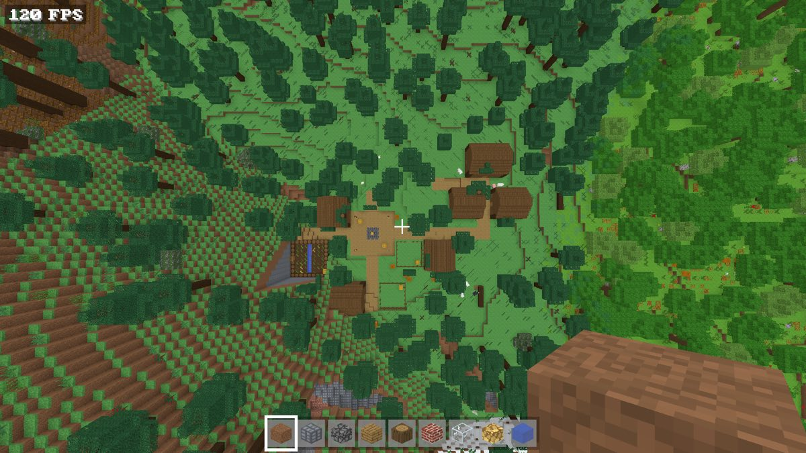
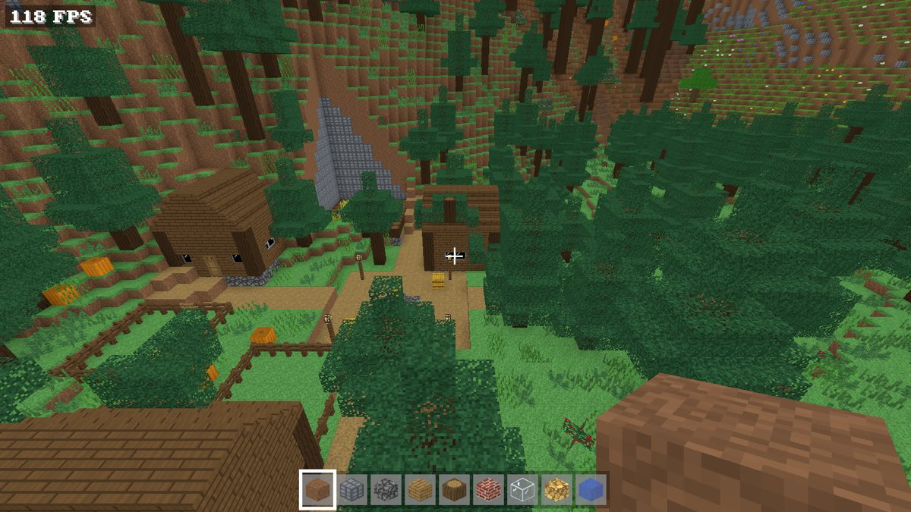
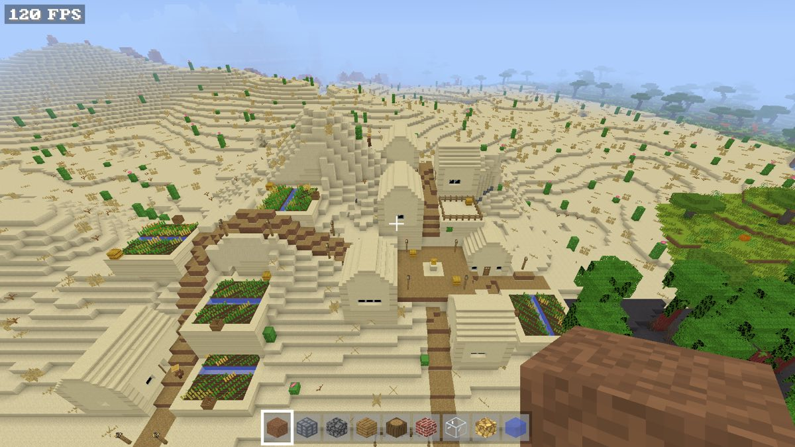

# v0.14 jigsaw engine and villages (GEN-05a, GEN-05b, GEN-07, 2026-11-03)

[Documentation index](../README.md) · [Roadmap v0.14](../roadmap.md#v014-scope-structures) · [Villages](../villages.md#generation-3-jigsaw-villages)

Items 0–3 of v0.14 and its GEN-07 check. Implemented and covered by
automated tests and screenshots, not yet played by the owner. Everything
that changes generated output applies to `Generation::V3` (new worlds)
only. Golden hashes pin generations 1 and 2.

- Requirements: GEN-05a, GEN-05b, GEN-07.
- Reference: Java's `JigsawPlacement`, `JigsawStructure` and the village
  structure settings (start pool, size 6, 80 blocks), as publicly
  described. No Mojang template, pool file or layout was used: the
  templates in `src/world/jigsaw/village.txt` are original (owner,
  2026-11-03, no fidelity exception recorded yet).

## What changed

- **World generation 3** (`terrain::Generation::V3`, now the latest). It
  uses generation 2's terrain; only its villages differ. `level.txt`
  records `worldgen=3`, and LAN players get it in `Welcome` (protocol 4
  already carries the number, and host and client versions must match).
- **Jigsaw engine** (`src/world/jigsaw.rs`). It has a template text format
  with style roles, connectors and beds, weighted pools with fallbacks
  and an empty element, the assembler, and painting clipped to each chunk
  with foundations and clearing. The algorithm is described in
  [villages](../villages.md#generation-3-jigsaw-villages).
- **Villages** (`src/world/village.rs`). Generation 3 assembles each
  village from `village/town_centers` and paints it with the style's
  palette. Chests, job sites and beds become the same `Feature`s as
  before, so loot, block entities, villager homes and saved containers
  work unchanged. Generations 1 and 2 keep the hand-grown layout.
- **GEN-07 corpus** (`src/world/terrain/order_tests.rs`). Generations 1, 2
  and 3 generate a corpus in row order, shuffled, on six threads and with
  the structure caches emptied. Every run gives identical blocks and
  structure features. The corpus covers a village, temples, a mineshaft,
  dungeons and negative chunk borders.
- **Generation 2 golden hash** (`generation_2_chunk_hashes_stay_identical`).
  It hashes blocks and structure features over generation 1's chunk set
  plus each seed's nearest village, mineshaft and three temple-family
  structures. It was captured before the village change, and it still
  passes after it.
- **Save/reload** (`app::startup::tests`). A new world saves `worldgen=3`
  and reloads as generation 3; worlds with `worldgen=2` or no key keep
  generations 2 and 1.
- **Bench**. `--bench` reports chunk generation time for generations 1–3
  around the origin, the nearest jagged peaks and the nearest village.

## Checks

Full chain on the integrated branch: `cargo fmt && cargo clippy --release
--all-targets -- -D warnings && cargo test --release` passes (1,885 tests,
0 failures). `lan_loopback` failed once while another build was running
(its two-second shutdown deadline) and passed three runs out of three on its own.

New tests:

| Test | Shows |
| --- | --- |
| `jigsaw::tests::rotations_turn_clockwise_like_java` | Rotation matches Java's `Rotation` for positions and facings |
| `jigsaw::tests::the_village_file_parses_and_every_connector_can_attach` | Every connector faces out of its template and its pool can answer it |
| `jigsaw::tests::parse_errors_name_the_line` | Template errors name the line |
| `jigsaw::tests::assembly_is_deterministic_and_pieces_never_overlap` | 40 seeds on flat and hilly ground give repeatable layouts with no shared blocks inside 80 blocks |
| `jigsaw::tests::connected_pieces_meet_at_their_connectors` | Each piece hangs off an earlier piece's matching connector |
| `jigsaw::tests::the_last_depth_only_takes_fallbacks` | Pieces past the last depth come only from the fallback pool |
| `village::tests::*` (generations 2 and 3) | All five styles; no overlaps; chunk painting agrees when shifted by one block in three places; every bed, chest and job site is in the generated chunk; layouts survive cache eviction; streets bridge water on planks; every style resolves every role |
| `village::tests::generation_3_villages_have_homes_jobs_and_chests_on_average` | 45 villages near seed 42: 314 beds, 269 chests and 269 job sites |
| `village::registration_tests::*` (generations 2 and 3) | Chests and job sites register, and emptied chests stay empty after a save and reload |
| `terrain::order_tests::*` | GEN-07 corpus (above) |
| `terrain::tests::generation_2_chunk_hashes_stay_identical` | Generation 2 is unchanged |
| `app::startup::tests::new_worlds_save_and_reload_as_generation_3` | `worldgen=3` round trip |

Chunk generation, one thread, seed 42, `--bench --rd 4` (588 chunks per
row), two runs on the owner's M5 MacBook Pro:

| Place | Generation 2 | Generation 3 |
| --- | --- | --- |
| Origin | 0.570–0.571 ms | 0.570–0.571 ms |
| Mountains | 0.807–0.808 ms | 0.806–0.809 ms |
| Nearest village | 0.583 ms | 0.581–0.585 ms |

Generation 3 villages cost the same as generation 2's: the layout is built
once per village and cached, and each chunk paints only the pieces whose
columns it holds.

## Screenshots

New worlds were created with `--new --seed 42` and `--seed 7`, and the
camera was posed over the nearest village (`--pose`, `--screenshot`). The
images show plazas with bells and lamps, terrain-following streets,
small and medium houses with doors, windows and stair roofs in their style's
materials, irrigated farms and fenced pens.

## Known gaps

- The templates aren't Java's: no seed reproduces a Java village, and the
  GEN-05b layout acceptance waits for the owner's template decision.
- No beardifier. Pieces on slopes stand on pillars, and clearing above them
  cuts hillsides (the grey cut in the taiga street image), as generation 2
  villages also do.
- Job sites are random per house, and there are no profession buildings,
  abandoned villages, decorations, or animals and cats spawned in pens.
- Not modelled from Java: placement and selection priorities other than 0,
  the expansion hack, and processors other than the bridge rule.
- Not yet checked: the owner's play of a generation 3 world and the
  frame-time gate (v0.20).
