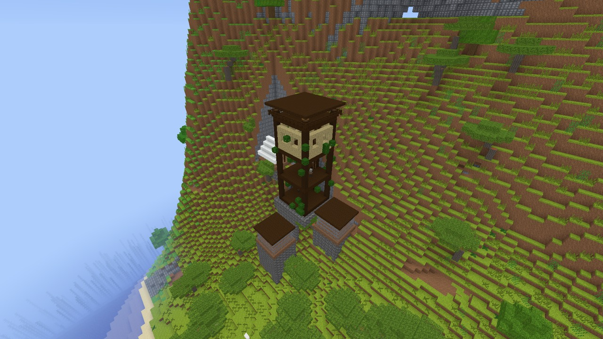
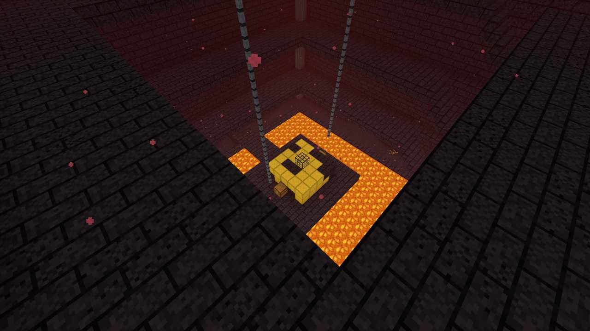
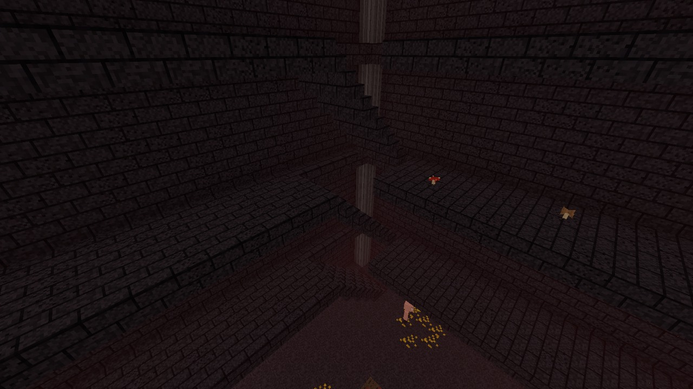
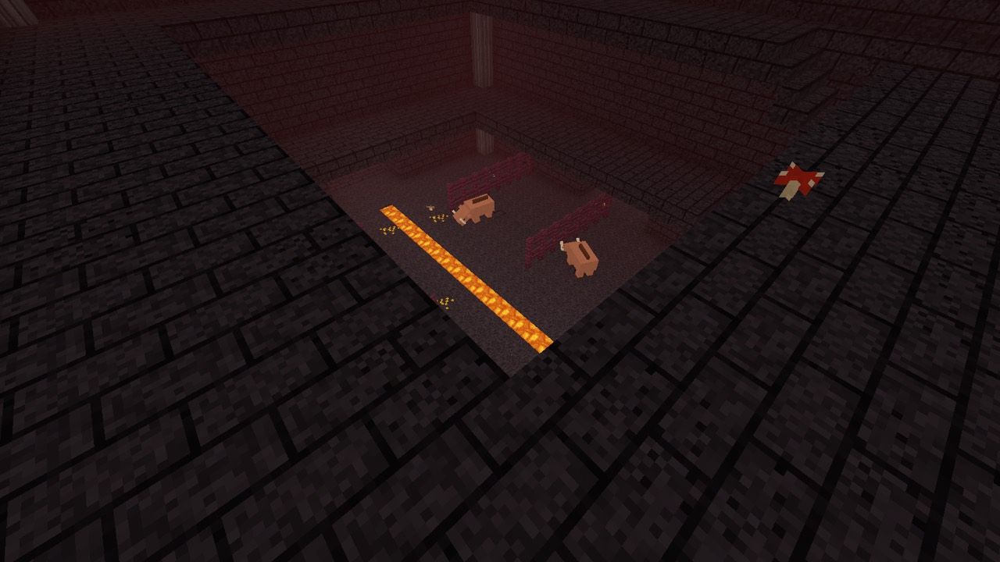
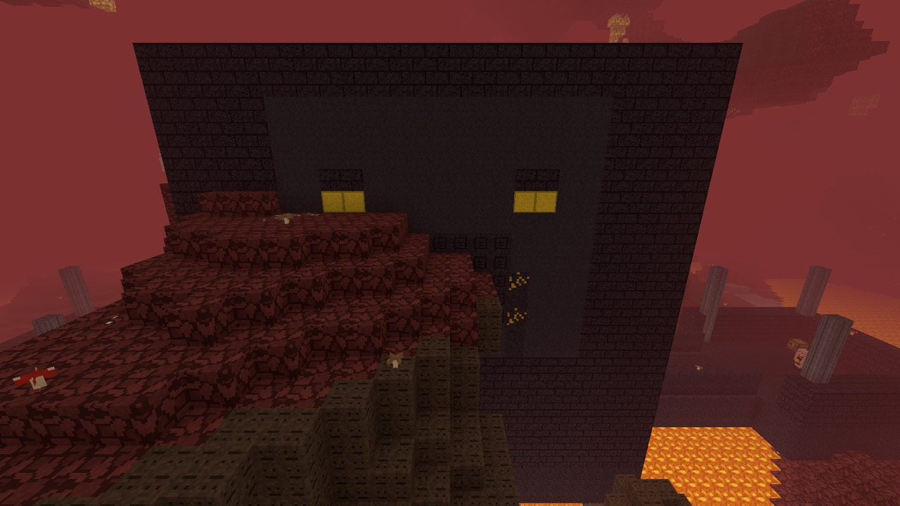

# v0.14 template outposts and bastions (GEN-05e, GEN-05g, GEN-07)

[Roadmap scope](../roadmap.md#v014-scope-structures) · [Track reservations](../architecture.md#v014-track-reservations) · [Jigsaw villages](2026-11-03-v0.14-jigsaw-villages.md)

Implementation track 4, based on engine extension `b53ac92`. Original
VoxelCraft templates, as approved on 2026-11-03; no Minecraft template
layout or Mojang asset was copied. Block geometry was never decoded or
transcribed from NBT. Implementation and automated evidence
are separate from the owner's ordinary play and Java layout acceptance.

## Allocation and compatibility

No new block states, items or texture layers. Track reservations
10240–10367, 1240–1244 and 2896–2911 remain unused. Existing materials,
shapes, targets, chests, magma cube spawners and entities are reused.
No saved enum order, feature kind, loot table or storage format changes.
All generated layout, feature and resident changes require generation 3.
Generations 1 and 2 retain the original builders and population path.

## Implementation

- `jigsaw/outpost.txt`: Java pool names `pillager_outpost/base_plates`,
  `towers`, `feature_plates` and `features`. A foundation plate connects
  vertically to a dark oak/birch tower with ladder, intermediate floors,
  windows, lookout, roof, chest and three pillagers. Four terrain-following
  feature plates select the seven features at weight 1 each or empty at
  weight 6: two iron-golem cages, an empty allay cage, logs, two tents and
  existing redstone target blocks. All pools fall back to `empty`.
  An original overgrown leaf overlay uses Java `outpost_rot`: 0.05
  integrity, `nextFloat() <= integrity`, with skipped cells preserving the
  base tower/world block.
- `temples/outpost_templates.rs`: depth 7, distance 80; surface-projected
  starts; marker conversion to existing `TempleChest(Outpost)` and
  resident records. `Built` retains template placements and paints through
  the shared engine. The complete piece bounding box drives pillager
  spawning. Placement, village exclusion, biome tests and loot are retained.
- `jigsaw/bastion.txt`: four equally weighted Java-named starts, housing
  with stacked floors and stairs, lava-channel hoglin pens with crimson
  fences, a treasure hall with magma/lava, gold island and magma cube
  spawner, a solid rim containing the lava, and a piglin-faced bridge
  entrance. Walkable bridges join the starts to ramparts. Materials reuse existing blackstone, polished
  blackstone bricks, gilded blackstone, basalt, gold, magma, lava, soul
  sand, nether wart and chains. Depth 6, distance 80, absolute y 33, rigid.
- `bastion/templates.rs`: chunk and 1×32×1 column painting share
  `paint_canvas`, with no clearing or foundations into Nether terrain.
  Chest markers retain the four existing `ChestKind` tables and their
  netherite-upgrade behavior. Treasure spawners use `Feature::Spawner`.
  Generic degradation applies the five ordered Java rules, with Java's
  position seed, signed overflow, legacy random and float predicates.
- Bastion resident markers name a mob pool. The weighted element selects
  an original marker-only template: piglin melee/sword/crossbow/empty
  1/4/4/1; hoglin/empty 2/1; melee-always/melee/sword 1/5/1.
  `entity/nether.rs` spawns at those marker cells with the selected weapon,
  keeps persistent homes and population receipts, and waits for marker
  cells to load. Legacy residents still come from `residents(PieceKind)`.
- Discovery radii include the larger generation 3 layouts. `/locate`
  continues using existing structure services.
- Small additive engine fix: vertical connectors preserve the assembled
  target height even when their parent is terrain projected. Re-projecting
  the child down to the heightmap put it inside an already occupied feature
  plate, preventing all outpost features from attaching. The three-piece
  regression covers a rigid base, terrain plate and rigid vertical child.
  Horizontal village assembly is unchanged. The engine also exposes the
  shared Java position-random helper used by bastion degradation and
  outpost rot.
- GEN-07 adds an explicit generation 3 outpost and a separate Nether
  treasure-bastion corpus. `--bench` adds generation 2/3 timing at the same
  nearest-outpost and nearest-bastion coordinates.

## Java reference

Read-only Java 26.3 extraction supplied for this task:
`target/java-ref/data/minecraft/`, specifically:

- `worldgen/structure/{pillager_outpost,bastion_remnant}.json`;
- `worldgen/template_pool/pillager_outpost/{base_plates,towers,feature_plates,features}.json`;
- `worldgen/template_pool/bastion/starts.json` and
  `bastion/mobs/{piglin,piglin_melee,hoglin}.json`;
- `worldgen/processor_list/{bastion_generic_degradation,outpost_rot}.json`.

The behavior of `RuleProcessor`, `RandomBlockMatchTest`, `BlockRotProcessor`,
`StructurePlaceSettings`, `SinglePoolElement`, `LegacySinglePoolElement`
and `Mth.getSeed` were checked against decompiled classes from the supplied 26.3 server jar,
extracted into this worktree's ignored `target/outposts-bastions/java/`.
A standalone Java `java.util.Random` fixture evaluates the five material
inputs at y=33, x/z=-32..31: 20,480 pairs, FNV-1a result
`ebdf26e37d2d287e`, output counts 16010 unchanged, 2410 cracked bricks,
0 air, 2031 blackstone and 29 gilded blackstone. The Rust regression pins
that fixture, independently of chunk painting. A second Java fixture for
outpost rot at y=70, x/z=0..31 retains 39 of 1,024 cells. Its painting
regression verifies both retention and unchanged underlay on skipped cells.

The five bastion mob resources were checked **only for behavior identifiers**
in memory from the supplied server jar: `melee_piglin` and
`melee_piglin_always` identify `piglin_brute`; `sword_piglin` identifies
`piglin` / `golden_sword`; `crossbow_piglin` identifies `piglin` / `crossbow`;
and `hoglin` identifies `hoglin`. No block list or position was decoded and
no NBT resource was written to disk or included in the project.

## Checks

Checked source: `b0ef9651987bcb16b953144aa420493fd80af684`, macOS 27.2,
arm64, Apple M5, 2026-11-03. The owner's v0.14 Codex implementation override
applies to this track. Every Cargo command used
`CARGO_TARGET_DIR=/Users/brendanhallas/.t3/worktrees/minecraft_rust/shared-target`.
`build.rs` was touched before checks; a package-only release clean kept the
shared dependencies and removed stale worktree output.

```sh
cargo fmt && cargo clippy --release --all-targets -- -D warnings && cargo test --release
```

Pass: **1,902 tests passed, zero failed, 19 ignored**. Existing ignored
cases remain ignored. The library contributes 1,400 passed / 14 ignored,
and the client executable 199 passed / one ignored; integration tests make
up the balance. The unchanged generation 1 and generation 2 golden hashes
both pass. The new generation 3 Overworld and Nether GEN-07 tests pass.
The full log is retained in ignored `target/outposts-bastions/handoff.log`.

Device-independent chain also passes: **1,702 tests passed, zero failed,
18 ignored**, including the new rot fixture, both legacy hashes and GEN-07.
Log: ignored `target/outposts-bastions/headless.log`.

```sh
cargo clippy --release --no-default-features --all-targets -- -D warnings && cargo test --release --no-default-features
```

| Evidence | Coverage |
| --- | --- |
| Outpost rot | Independent Java position-random fixture: 39/1,024 overlay cells retained, skipped cells keep their stone underlay |
| Outpost pool/layout test | 160 seeds; every feature appears; repeatable layout and markers; no piece overlaps; feature weights 1 each / empty 6 |
| Outpost shifted-chunk test | 12 seeds; all overlapping blocks agree; chest and resident cells match painted blocks, with clear supported resident positions |
| Outpost registration/reload | Actual seed-42 generated chest registers, fills and stays empty after serialization, reload and regenerated feature registration |
| Bastion layout test | 120 seeds; all four starts; repeatable pieces/residents; no overlaps; supported clear marker cells; hoglin population |
| Bastion painting tests | Every kind; shifted cubes, chunk/column canvases, and public `Bastions::paint` / `column_at` agree |
| Bastion content tests | Exact Java start/mob-pool weights; the independent 20,480-pair Java degradation fixture; chest and magma-spawner markers match their blocks |
| Bastion routes / fluids | Routes from each start entrance through bridges and stairs to every chest, allowing one-block jumps; treasure lava has no horizontal or downward escape |
| Bastion registration/reload | Generated treasure chests retain guaranteed upgrades; magma-cube spawner registers; emptied chest remains empty after save/reload |
| Entity integration | Selected residents spawn at marker cells with their selected weapons and persistent homes; saved population receipts prevent duplicate or dead-resident respawning |
| Jigsaw regression | A rigid base, terrain plate and vertical child connect at heights 70/71/72 over 16 seeds |
| GEN-07 | Explicit outpost chest in the V3 Overworld corpus; complete negative-region treasure bastion in reverse, parallel and fresh-cache Nether runs |

Early checks found a missing `empty` fallback, a non-canonical gold block
name and the vertical terrain-plate attachment defect; these are fixed.
The legacy sparse-block painting fixture now explicitly uses generation 2,
with separate generation 3 template tests. A test-module qualification
error was also corrected before the passing chain. Earlier failure logs
remain under `target/outposts-bastions/`.

## Generation timing

Preserved release binary `target/outposts-bastions/voxelcraft-b0ef965`,
`--bench --rd 4 --seed 42 --data-dir target/outposts-bastions/bench`, two
runs. Each row uses a fresh generator and the same 7×7 chunk columns across
all dimension rows: 588 Overworld chunks or 392 Nether chunks.

| Scene | Generation 2, ms/chunk | Generation 3, ms/chunk |
| --- | --- | --- |
| Nearest outpost, (-232, 97, 1096), run 1 | 0.530 | 0.523 |
| Same outpost, run 2 | 0.528 | 0.528 |
| Nearest bastion, (294, 33, 457), run 1 | 0.176 | 0.175 |
| Same bastion, run 2 | 0.178 | 0.177 |

These paired runs used AC power and held a single BSD `flock` on the
shared target's `release/.cargo-lock`, excluding Cargo compilation. Capture
processes had finished. These are chunk-generation averages, not a
frame-time acceptance result. Logs: ignored
`target/outposts-bastions/bench-{1,2}.log`.

An initial timing helper requested both BSD `flock` and POSIX `lockf` and
self-blocked on macOS. Sampling identified the second lock call; only that
owned helper was cancelled, releasing its locks. No Cargo process was
terminated. The results above come from the corrected single-lock helper.

## Screenshots

Scripted new-world captures from the preserved tested binary, with
`--new --creative --mute --no-hud --no-update-check --rd 4`, isolated under
`--data-dir target/outposts-bastions/captures`. Logs report zero modified
chunks and zero scripted placements. Static PNG artifacts were inspected,
then resized to 1280×720 JPEGs (each below 300 KB). The first two captures
use `--wait 2 --time 0.25 --weather clear`.

- Outpost: seed 42, Overworld, world `v014-outpost`,
  `--pose -266,125,1130,-45,-34`. Shows the dark oak/birch tower, its sparse overgrown leaf dressing
  and cages. The hillside also exposes the foundation/terrain adaptation
  gap described below.
- Treasure bastion: seed 9, Nether, world `v014-bastion`,
  `--pose 11,55,237,-45,-53`. Shows stacked ramparts and chains,
  lava containment, gold centre, loot chest and magma-cube spawner.

Additional fresh Nether worlds cover the remaining three kinds:

| Kind / world | Seed | Pose | Wait |
| --- | --- | --- | --- |
| Housing / `v014-housing` | 3 | `289,51,54,135,-30.33` | 0 s |
| Stables / `v014-stables` | 2 | `342,48,103,131.63,-46.34` | 2 s |
| Bridge / `v014-bridge` | 10 | `150,53,33,90,-17.12` | 0 s |

Housing shows the connected stair flights and stacked floors, stables show
hoglins in fenced bays beside the lava channel, and the bridge shows its
piglin face and a connected rampart. A first bridge candidate (seed 1) was
correctly rejected in basalt deltas; seed 10 supplies the retained capture.
All screenshot processes exited normally. Original PNGs, captures' logs
and the preserved binaries remain in ignored `target/outposts-bastions/`.











## Changed files

- `src/bench.rs`
- `src/entity/nether.rs`
- `src/world/bastion.rs`
- `src/world/bastion/templates.rs`
- `src/world/jigsaw.rs`
- `src/world/jigsaw/bastion.txt`
- `src/world/jigsaw/outpost.txt`
- `src/world/temples.rs`
- `src/world/temples/outpost_templates.rs`
- `src/world/terrain/order_tests.rs`
- This verification record and the five JPEGs linked above.

## Differences and unverified behavior

- All geometry is original. The compact bastion graph keeps the names of
  the pools it uses, four start weights and complete mob-pool weights;
  it does not reproduce Java's full roughly sixty-pool catalogue or its
  weights for omitted architecture. Layout/assembly random streams remain
  the shared engine's deterministic VoxelCraft streams, not Java seeds.
- Outpost towers combine the original base and overgrown leaf dressing
  into one template rather than representing Java's list pool element as
  two assets. The dressing uses Java's `outpost_rot` processor, but its
  leaf pattern is original. Allays do not exist; the allay cage remains
  empty. Golem cages retain generated residents.
- The engine has no Java expansion hack or beardifier. Outposts use
  the village engine's terrain projection, foundations and canopy clearing;
  steep terrain can produce exposed foundations or cut hillsides.
- Bastions apply `bastion_generic_degradation`; Java's additional pool-
  specific processors are not reproduced. Mob markers choose pools at
  fixed original positions rather than placing Java's entity NBT. Brutes
  and armed piglins use existing entity behavior and persistence.
- Existing supported-item loot filtering and loot random streams are
  unchanged by this track; Java loot-random-sequence integration belongs
  to track 6. No claim of complete loot parity is made here.
- Owner play, Terra hands-on inspection and the release frame-time gate
  remain unverified by this implementation agent.
