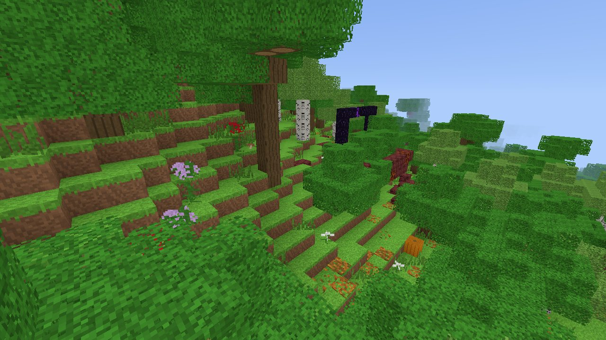
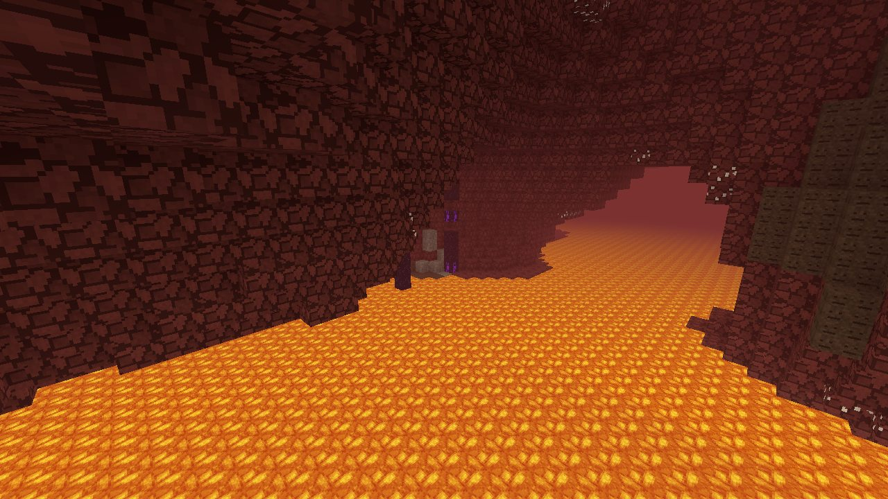

# v0.14 ruined portals and buried treasure (GEN-05f, 2026-11-03)

[Documentation index](../README.md) · [v0.14 scope](../roadmap.md#v014-scope-structures)

Track 5a, implemented in an isolated worktree by the owner's requested Codex
implementation agent (the provider choice is for this release run). No
Minecraft template or Mojang asset was copied. The thirteen portal designs in
`src/world/jigsaw/ruined_portals.txt` are original VoxelCraft geometry.
Everything that adds generated blocks or features is gated to `Generation::V3`.
This record describes agent evidence, not the owner's ordinary play.
Implementation source: `35e5e7084184333b93b0697120719cb0a9d216d9`.

## Implementation and allocations

- `ruined_portal.rs`: one shared Overworld/Nether random-spread grid, spacing
  40, separation 15, salt 34222645. All represented surface biomes map to the
  appropriate standard, desert, jungle, swamp, mountain or ocean settings;
  Nether biomes use the Nether settings. The seven weight-one variants are
  tried without replacement as in `ChunkGenerator.createStructures`, and the
  chosen height's biome must match the variant (Deep Dark starts are rejected).
  Standard and mountain placements
  choose their two equally weighted setups. There are ten normal and three
  giant templates, with a 5% giant choice, four rotations and both mirrors.
- The placement height follows Java's six vertical placement rules, including
  the three-supporting-corners scan. Base columns use the same density masks
  and surface rules as Overworld terrain filling and Nether classification.
  They never read loaded chunks. Projection uses base columns; processor
  canvases use locally recomputed pre-portal terrain, including carvers, ores,
  decorations and older structures, so spreading preserves real cave air.
- Template processing implements air-pocket filtering, 30% gold removal,
  placement/cold lava rules, 7% warm netherrack-to-magma, block ageing,
  15% crying obsidian, lava submersion and Nether blackstone replacement.
  It also implements the Manhattan-distance netherrack spread, up to nine
  blocks of drip columns, jungle leaves and vines. Represented members of
  `features_cannot_replace` (bedrock, spawners, chests, End portal frames)
  are protected. Spread cannot destroy the structure's chest.
- Templates are placed with `jigsaw::single`, painted with its single-column
  canvas, and expose their chest through `jigsaw::markers`. The mirrored
  library is computed once, without changing the shared engine. Sparse
  template cells leave terrain intact; there are no village foundations or
  clearing above portals. A bounded cache holds sorted world blocks and loot
  markers, and every chunk clips the same cached result.
- `buried_treasure.rs`: Java `legacy_type_2`, spacing 1, separation 0,
  frequency 0.01, large-feature salt 10387320, beach biome check at +8,+8.
  The chest is at +9,+9, scanning down from the ocean floor until its block
  below is sandstone/stone/andesite/granite/diorite. The scan reads locally
  recomputed pre-treasure terrain (including carvers, ores and existing
  structures), never loaded neighbouring chunks. A bounded cache avoids
  repeating that terrain work for each vertical chunk. Six open neighbours are
  filled according to the reference's below-neighbour rule, and chest facing
  follows `StructurePiece.reorient`.
- `/locate ruined_portal` works in both supported dimensions;
  `/locate buried_treasure` works in generation 3 Overworld worlds.
  `generator.buried_treasure.nearest_buried_treasure(&g, from, max_rings)`
  exposes Java's first-valid-start-on-first-occupied-ring search, x outer and
  z inner, with locate position `(chunk*16 + (9,9), y=0)` for explorer maps.
- Both loot tables use the existing `TempleChest` feature and container
  registration/persistence path. Pool order, weights, counts, enchantment
  flags and rolls follow the pinned Java 26.3 data, including the lodestone
  pool and water-breathing potions. Missing iron spears and nautilus armour
  retain empty weighted entries. Lodestone and all other supported items
  use their existing IDs.
- **No new block states, item IDs or texture layers used.** Track 5a's
  reserved ranges 10368–10495 / 1245–1249 / 2912–2927 remain unused. Existing
  save identifiers, `Feature` variants and loot-table enum ordering are
  preserved; the two new loot-table variants are appended.

## Reference facts and deliberate differences

The local reference is the owner's pinned Java 26.3 server at
`/Users/brendanhallas/Code/voxelcraft-java-reference/26.3/server-26.3.jar`.
`tools/extract_java_world_defect_fixtures.py` checks its SHA-1 before reading
it. The regenerated `world_defects.json` was compared structurally to the
old fixture with the two added tables removed: all previous facts match.

Read-only extracted data and decompiled behaviour were consulted under
`target/java-ref` in the reference worktree:

- `worldgen/structure_set/{ruined_portals,buried_treasures}.json`;
  `worldgen/structure/ruined_portal*.json`;
  `tags/worldgen/biome/has_structure/ruined_portal_*.json`;
  `tags/block/features_cannot_replace.json`;
  `loot_table/chests/{ruined_portal,buried_treasure}.json`.
- `RuinedPortalStructure.findGenerationPoint/findSuitableY`,
  `RuinedPortalPiece`, `BuriedTreasurePieces`, `BlockAgeProcessor`,
  `BlackstoneReplaceProcessor`, `LavaSubmergedBlockProcessor`.
- `ChunkGenerator.createStructures`, `StructurePiece.reorient`, `Half`,
  `BoundingBox.getCenter` and `Direction.Plane.HORIZONTAL` were independently
  decompiled into this worktree's ignored `target/portal-java-src` to check
  negative-coordinate centres and the horizontal direction ordering.

Differences and limitations:

- Layouts, sizes and template cell ordering are original. No seed reproduces a
  Java portal layout; the owner-approved original-template scope applies.
  Portals contain deliberately incomplete, unlit frames.
- Terrain and biomes are VoxelCraft's, so valid starts, selected biome setting,
  burial depth and supporting corners differ from Java worlds with the same
  seed. Buried treasure scans a deterministic pre-treasure snapshot rather
  than loaded neighbouring chunks or player edits. Both structures join
  VoxelCraft's existing structure/decorating order; Java's full structure
  step scheduling and cross-structure terrain interactions are not reproduced.
- The local climate's temperature and altitude rules determine coldness.
  Java's additional biome-temperature noise is not represented here.
- Template rule/age processing uses Java's position-seeded LCG; terrain
  spread, drips and foliage use the structure's deterministic Java random
  stream rather than Java's chunk-decoration stream. Original template
  dimensions and cell ordering also consume different random sequences.
- Lava submersion treats chests as partial shapes, as Java does, even though
  VoxelCraft's current chest geometry is a full cube. The focused test caught
  and corrected that representation mismatch.
- Wall ageing preserves the represented UP and waterlogged properties;
  other wall connections are derived by VoxelCraft. Template placement
  applies waterlogging where the existing block families support it.
  VoxelCraft vines store one attachment face and jungle leaves use the
  existing leaf state rather than a persistent flag. Unsupported trial spawners/vaults/reinforced
  deepslate have no states to protect.
- After integration (2026-11-03) both tables fill through track 6's Java
  `LootTable.fill` (`World::structure_loot`), so draw order and slot
  splitting follow Java for a given loot seed. Chest seeds are position hashes from the original
  jigsaw markers (treasure hashes its final chest position), not Java's
  template/decorator stream. Loot parity here is data parity, not identical
  seeded inventory contents.
- Owner play and the later frame-time acceptance gate remain unverified.

## Checks

A full test launch initially exited with SIGKILL before producing test output;
its shared-target executable was missing immediately afterward. A later run
passed all 1,399 active library tests, including both golden hashes and GEN-07,
then could not launch the next test executable because it had disappeared from
the shared target. Final checks use `RUST_TEST_THREADS=1` and a local Cargo
runner in ignored `target/` that preserves the whole suite when the first
executable starts, then launches each from a fresh local copy. This prevents
another worktree's cleanup during one test from removing the next executable.
Build output still uses the required shared target; no other worktree is
modified. GEN-07 still runs its six internal workers; the harness setting only
limits how many separate tests run at once.

All Cargo commands use
`CARGO_TARGET_DIR=/Users/brendanhallas/.t3/worktrees/minecraft_rust/shared-target`.
The final focused checks passed:

- `cargo test --release --lib world::ruined_portal::tests -- --nocapture`:
  8 passed, including all six vertical placements, Nether generation,
  13 templates/mirrors, giant/setup rates, processor properties and rates,
  cached chunk clipping, loot registration and saved empty containers.
- `cargo test --release --lib world::buried_treasure::tests -- --nocapture`:
  3 passed, including independent Java LCG coordinates/frequency, ring order,
  and actual generated beach/stone support and loot across four seeds.

The exact final hand-off chain passed:

```sh
cargo fmt && cargo clippy --release --all-targets -- -D warnings && cargo test --release
```

Clippy reported no warnings. Release tests: **1,901 passed, 0 failed,
19 ignored**, across 44 result groups including doctests. Both generation 1/2
golden chunk hashes, base-column agreement, the generation 3 Overworld and
Nether GEN-07 corpora, loot-table fixtures and container persistence checks
passed. The expected
hashes were not edited.

The agent-guide headless checks also passed:

```sh
cargo clippy --release --no-default-features --all-targets -- -D warnings
cargo test --release --no-default-features
```

Headless Clippy reported no warnings. Tests: **1,701 passed, 0 failed,
18 ignored**, across 43 result groups including doctests. The successful final
logs are `target/final-default-checks.log` and
`target/final-headless-checks.log`.
`--bench` now includes an area centred on a ruined portal for all three world
generations, in addition to origin/mountains/village.

## Benchmark

Fresh release binary, Apple M5 / Metal, seed 12345, two executions of
`target/portals-voxelcraft --bench --seed 12345 --rd 4`. The new benchmark
row generates 588 chunks on one thread at the nearest valid portal's x/z
position, on a fresh generator for each world generation.

| Generation | Run 1 | Run 2 |
| --- | --- | --- |
| 2 | 0.578 ms/chunk | 0.580 ms/chunk |
| 3 | 0.626 ms/chunk | 0.626 ms/chunk |

The generation 3 row includes uncached structure layouts and their deterministic
terrain snapshots. These are generation timings during the release work,
not the later frame-time acceptance gate. Full output remains in ignored
`target/portals-bench-{1,2}.log`.

## Screenshots

Both images are unmodified generated terrain: no scripted block placements
or mob spawns. Captured from the same release binary with `--new --seed
12345 --creative --rd 3 --size 1280x720 --no-hud --mute --time 0.25
--weather clear --wait 0.5`, isolated under `--data-dir
target/portal-captures`. The PNGs were converted to 1280×720 JPEGs at quality
83, about 200 KB each. These are scripted agent captures, not owner play.

- Overworld: `--dimension overworld --world ow-close --pose
  -7399,84,-6934,45,-20`; surface portal on a forest slope, partly hidden by
  the canopy. Raw capture: `target/ow-close.png`.
- Nether: `--dimension nether --world nether-side --pose
  46,40,-15,135,-14`; giant portal partly embedded in netherrack above the
  lava sea. Its crying-obsidian columns are visible from the cavern.
  Raw capture: `target/nether-side.png`.




