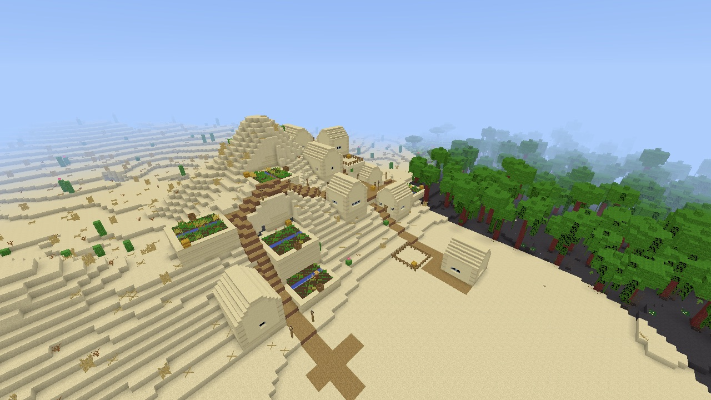
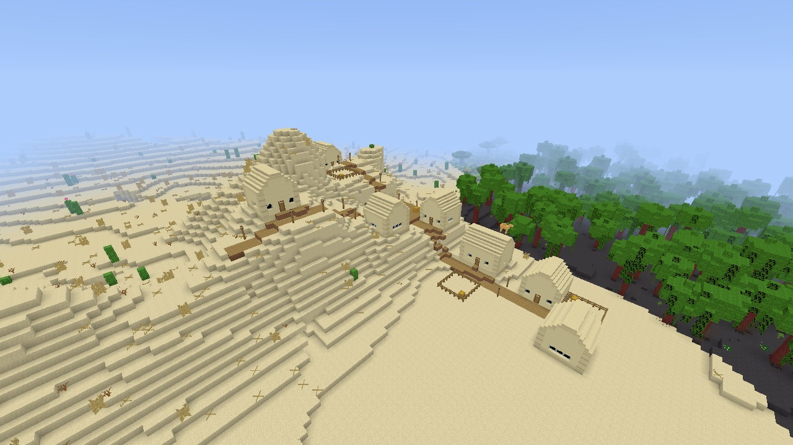
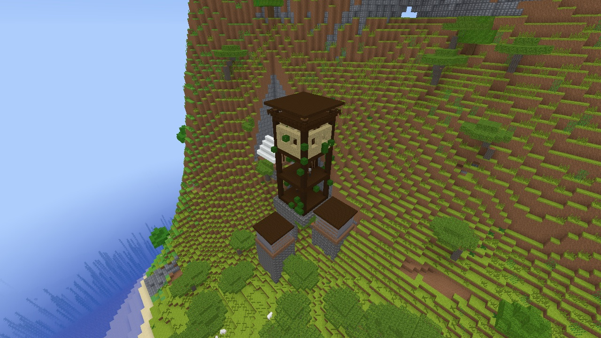
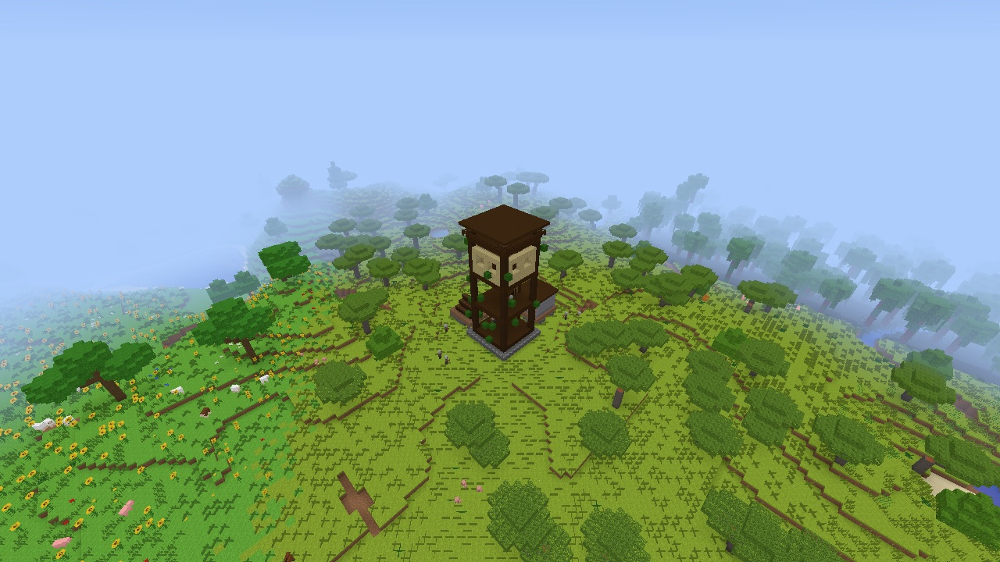
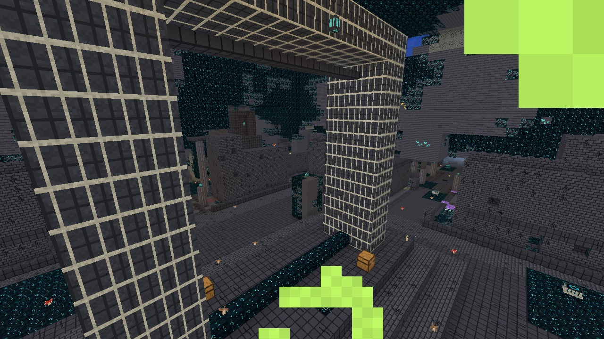
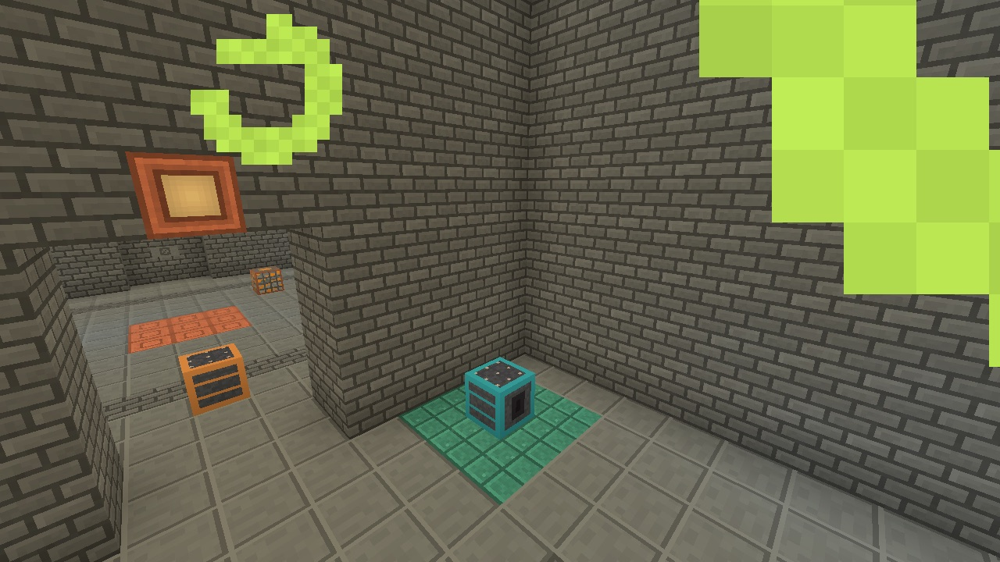
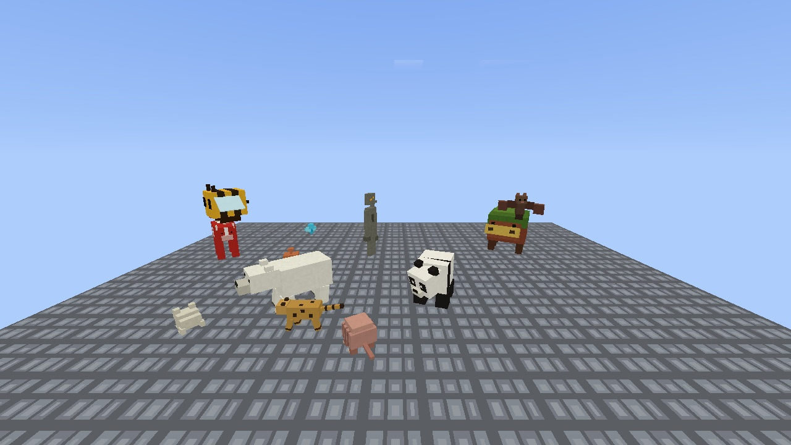
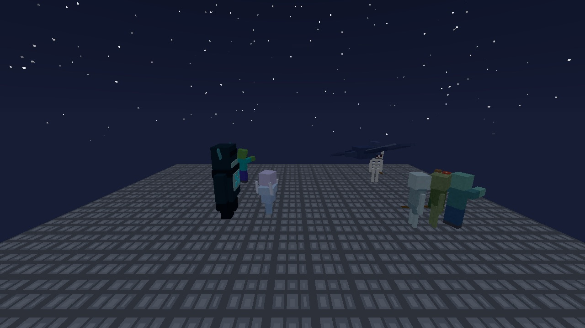

# Stabilisation pass: an agent run of v0.14 to v0.16 — 2026-11-09

[Roadmap gate](../roadmap.md#stabilisation-gate-before-v017) · [Audit](2026-11-09-project-audit.md) · [Documentation index](../README.md)

v0.14, v0.15 and v0.16 were merged without the game being started
([audit finding 1](2026-11-09-project-audit.md#1-three-versions-were-merged-and-never-run)).
This is the first agent run of that content. It is agent evidence under
[roadmap §7](../roadmap.md#7-feature-completion-and-release-policy): it
shows the game starts and draws the new content, and lists what was seen.
It is not the owner's play and moves no row to Verified.

## Builds and method

- **Source:** the audit branch after its four tracks merged
  (data fixes, entity frame time, terrain blending, documentation).
  Captures marked *before* come from the tree without terrain blending,
  *after* from the final tree.
- **Build:** `cargo build --release --offline --locked --bin voxelcraft`
  on the owner's M5 in the shared target directory, after
  `cargo clean --release -p voxelcraft` and `touch build.rs`.
- **Scenes:** `--screenshot` runs at 1280 × 720 in new creative worlds
  (generation 3), each with its own `--data-dir` under the ignored
  `target/audit-captures/`. Structure positions came from the new headless
  locator, run on a Namespace instance:
  `cargo run --release --no-default-features --example locate_structures -- <seed>`.
  Poses are `x,y,z,yaw,pitch`; a camera at `x-40, y+35, z+40` with yaw -45
  looks at a structure at `x, y, z`.
- **Checked by:** Claude Fable 5.2 looking at every image. Eight are
  tracked in `docs/images/2026-11-09-*.jpg`; the rest stayed in `target/`.

## What was captured and seen

| Scene | Seed and pose | Seen |
|---|---|---|
| Desert village, before and after blending | 7, `-232,100,-232,-45,-28` | Before: farms and houses on sandstone pedestals. After: no pedestals; six houses and the pens sit on a ridge the ground meets; the farm plots are gone (their floors couldn't fit) |
| Taiga village, before and after | 42, `-424,107,-744,-45,-30` | Before: five houses, a cut in the hillside. After: the town centre and two houses on level ground; the houses toward the steep hill are gone |
| Outpost, before and after | 42, `-266,125,1130,-45,-34` then `1510,116,-2886,-45,-34` | Before: tower and tents on stone pedestals on a steep slope. After: that start is rejected and the slope is bare; the nearest surviving outpost stands on gentle ground with its base flush |
| Ruined portal | 42, `240,78,368,-45,-32` | Frame, crying obsidian, netherrack spill and chest, in a cherry grove beside a beach |
| Trail ruins | 42, `-420,72,132,-45,-35` | Nothing above ground in a birch forest, as expected of a buried structure; the buried rooms were not dug out |
| Warm ocean ruin | 42, `-228,54,356,-45,-35` | Sandstone ruin pieces on the sea floor through the water fog |
| Ancient city | 42, `136,-38,186,-45,-15` and three more | Reinforced deepslate frame, deepslate brick walls and streets, sculk patches, sensors, shriekers and chests. Water from a cave outside falls into the city (a recorded gap of the `beard_box` approximation) |
| Trial chamber | 42, `265,-30,105,-45,-15` | Tuff brick room with a trial spawner on its copper floor, a vault, a copper light and a second spawner down the corridor |
| v0.15 mobs | platform at y 150, `0.5,153.5,0.5,0,-14` | Bee, frog, polar bear, panda, armadillo (rolled), ocelot, mooshroom, copper golem, creaking, allay, sniffer and bat all drawn, on the ground, facing sensibly |
| v0.16 mobs | same platform at night | Warden, breeze, stray, bogged, drowned, phantom, zombie and skeleton all drawn |
| New potion items | survival, `--open-inventory` | Fermented spider eye, Invisibility, Night Vision, Weakness and splash Weakness icons; the Invisibility effect and its timer in the HUD |
| Invisible first-person arm | survival, `--effect invisibility,600` | The bare arm still drew under Invisibility in the first build. Fixed (Java's `renderArmWithItem` skips the arm) and recaptured: no arm, held items unaffected |

No run crashed or logged an error. The lime blocks in the ancient city and
trial chamber images are the player's own Night Vision particles close to
the camera; Java draws its `SpellParticle`s there too, so they are not a
defect, only in the way of the capture.

## Hands-on play

Not reached. GPT-6.1 Terra was asked twice for a 30-minute play session
(menus, movement, a village and its trades, brewing, the new mobs, a trial
chamber, an ancient city and the warden, save and reload) and played for
zero minutes both times:

1. **As a bare executable.** Computer use didn't list the game as an app
   and returned `Invalid app` by path and by name. The 2026-11-05 graphics
   review hit the same thing.
2. **As an app bundle** (now `scripts/test-app.sh`). The bundle was listed
   as running under its identifier, but attaching returned
   `cgWindowNotFound`. The cause was the machine, not the game: the owner
   was away and the screen was locked
   (`CGSSessionScreenIsLocked` true), and a locked session has no windows
   to attach to. The same lock is why no windowed frame-time run was valid
   that day.

So the bundle fixes the first blocker and the second needs an unlocked
screen. The recipe is in the
[development guide](../development.md#hands-on-runs). Hands-on play of
v0.14 to v0.16 is still owed.

## What this did not check

- Anything that needs input: menus, movement, combat, trading, brewing at
  a stand, the warden and trial spawner encounters, save and reload.
  Hands-on play reached none of it.
- Sound and music.
- Bastions and Nether fossils (the Nether was not visited), desert wells,
  buried treasure, cold ocean ruins, and the inside of trail ruins.
- The v0.15 crops, bees' nests, copper golem statues, creaking hearts and
  ocean-ruin brushing, which earlier records captured individually.
- Frame time. The [entity frame-time record](2026-11-09-entity-frame-time.md)
  has the day's offscreen comparison runs; no windowed gate run was valid.

## Problems found

| Problem | Disposition |
|---|---|
| The bare first-person arm drew under Invisibility | Fixed in this change, with a unit test |
| Villages and outposts stood on pedestals | Fixed for generation 3 by [terrain blending](2026-11-09-structure-terrain-blending.md); villages on steep ground are now smaller or absent |
| Water falls into the ancient city from a cave beside it | Known gap of the `beard_box` approximation; stays with the ancient city catalogue work (v0.17) |
| Blended villages lose their farms first | Farm plots are the widest rigid pieces, so they fail the floor envelope most often. Worth a look when the village catalogue is redone (v0.17): narrower or terrain-following farm pieces would survive |
| Computer use can't see a bare executable, or any window while the screen is locked | `scripts/test-app.sh` wraps a build in an app bundle; hands-on runs need the owner's screen unlocked |
