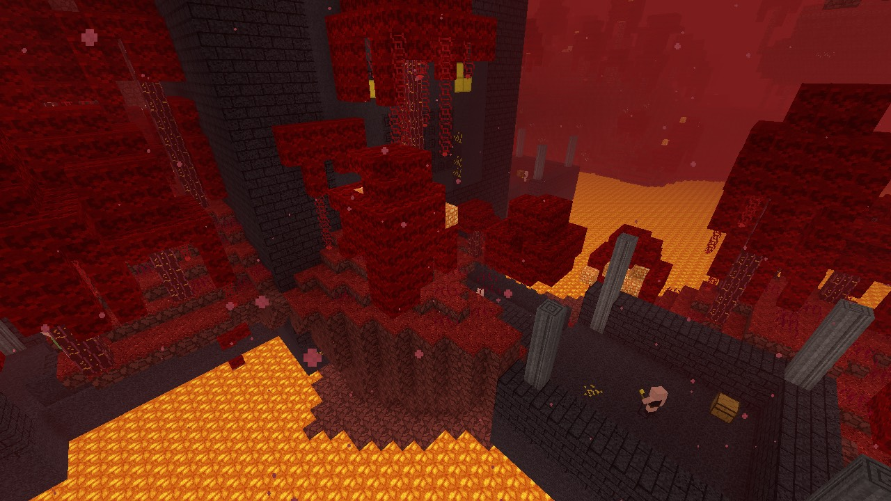
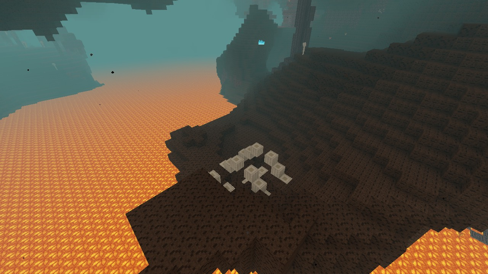
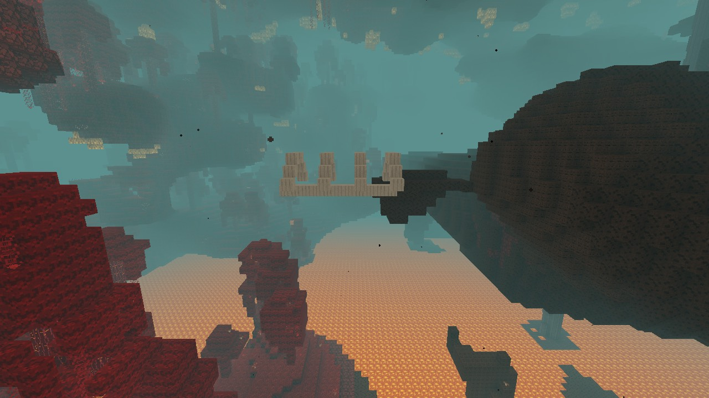
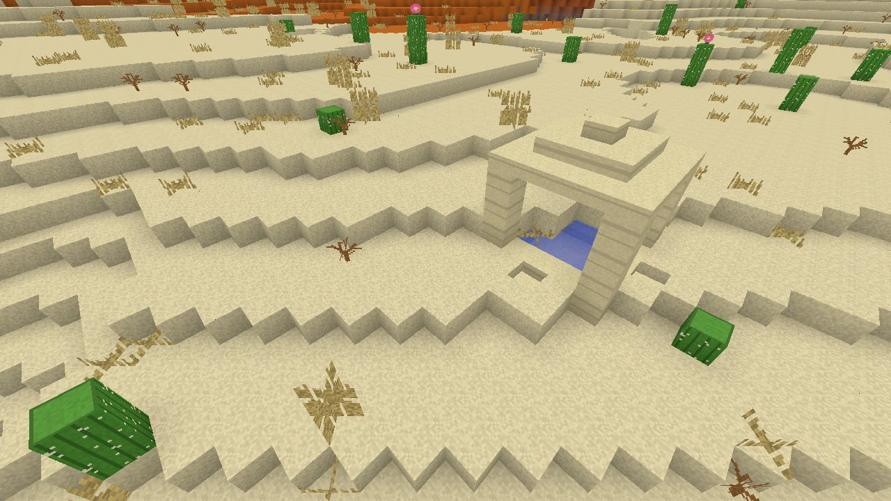
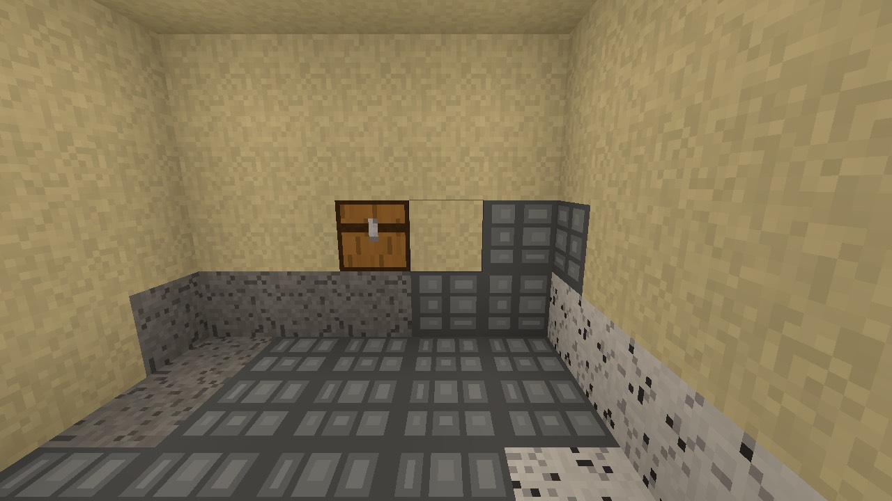
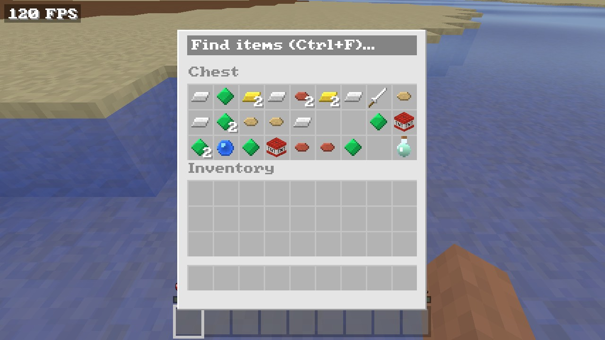
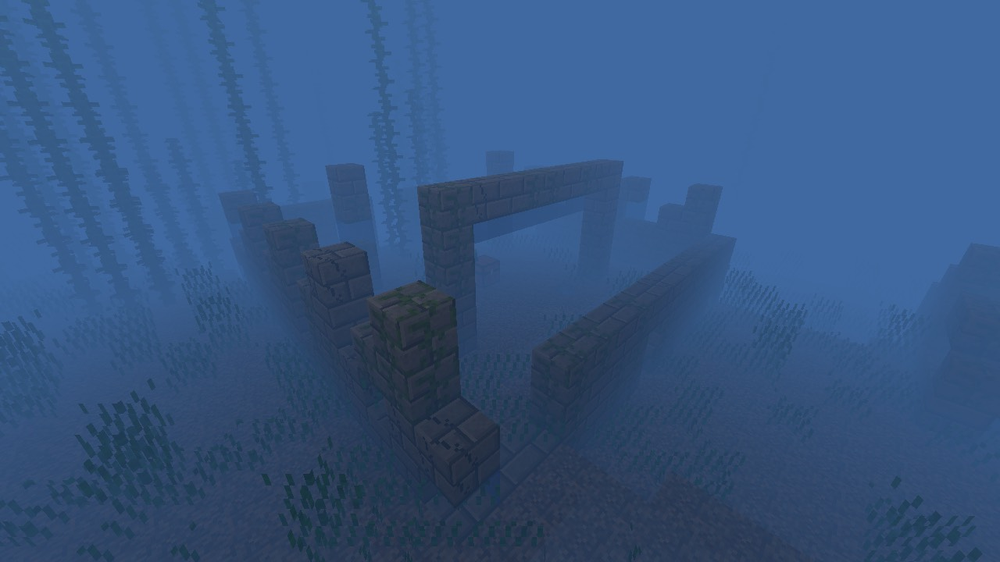
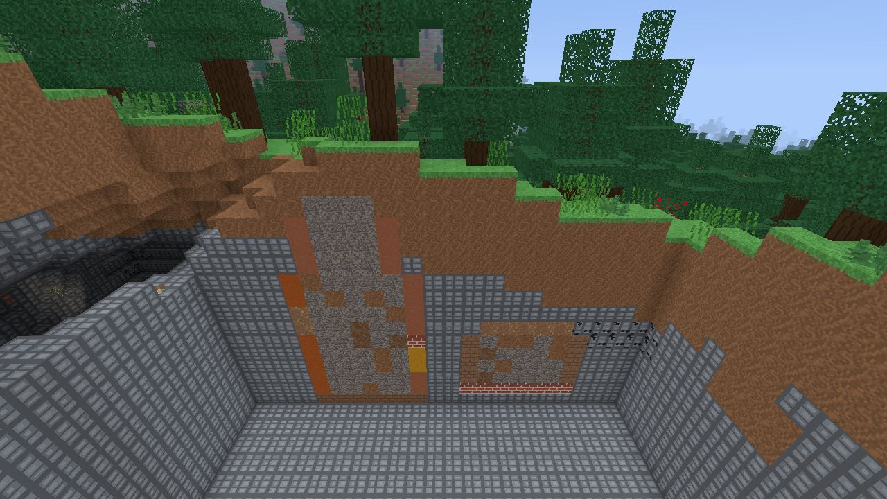
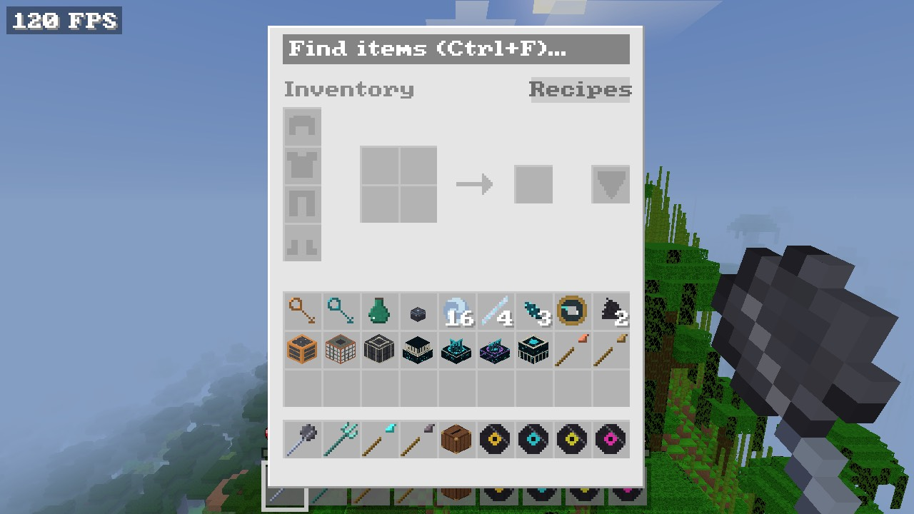
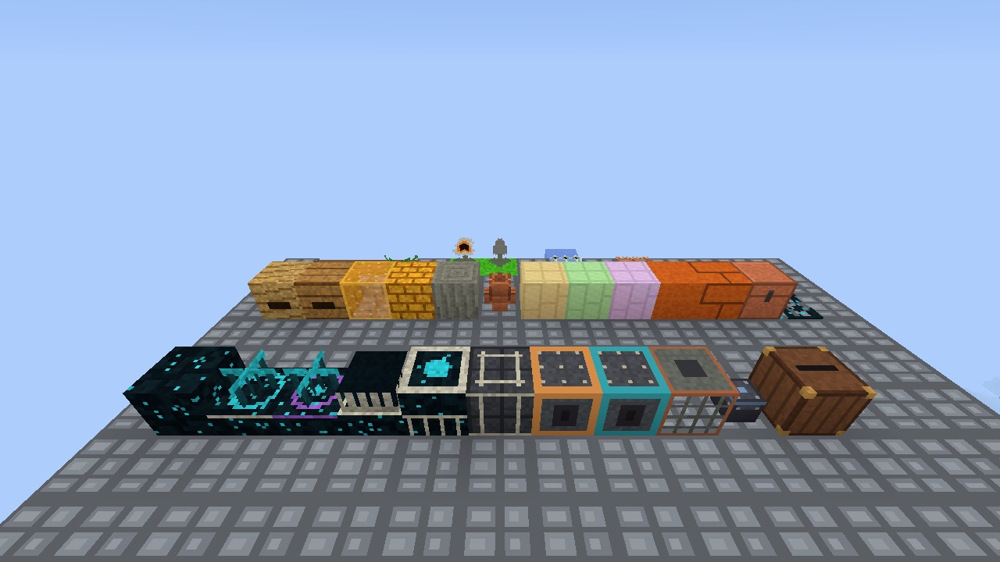

# Stabilisation captures: the v0.14 to v0.16 content the first pass missed — 2026-11-10

[Roadmap gate](../roadmap.md#stabilisation-gate-before-v017) · [First pass](2026-11-09-stabilisation-pass.md) · [Audit](2026-11-09-project-audit.md) · [Documentation index](../README.md)

The [2026-11-09 stabilisation pass](2026-11-09-stabilisation-pass.md)
drew villages, an outpost, a ruined portal, trail ruins from above, a warm
ocean ruin, an ancient city, a trial chamber and the new mobs. This run
covers what it listed as not captured: bastions, Nether fossils, desert
wells, buried treasure, cold ocean ruins, the inside of trail ruins, the
v0.15 blocks, ocean-ruin brushing, and the v0.16 items and blocks. It is
agent evidence under [roadmap §7](../roadmap.md#7-feature-completion-and-release-policy):
the game starts and draws the content. It is not the owner's play and
moves no row to Verified.

## Builds and method

- **Source:** `t3/finish-stabilisation-gate` at `277a6355`. No game code
  changed in this run, so every capture comes from one build.
- **Build:** `cargo build --release --locked --bin voxelcraft` on the
  owner's M5 in the shared target directory after `touch build.rs`. The
  binary is kept as ignored `target/stabilisation-captures/voxelcraft-final`.
- **Locating:** `examples/locate_structures.rs` now also prints the nearest
  desert well, the buried treasure chest's depth, the trail ruin's piece
  bounds, the nearest Nether fossil and the eight nearest bastions with
  their kind. It ran on a Namespace instance for seeds 42, 7, 12345 and 9:
  `scripts/remote-check.sh -- 'cargo run -q --release --no-default-features --example locate_structures -- <seed>'`.
- **Scenes:** `--screenshot` runs at 1280 × 720, `--rd 6`, noon, clear,
  `--no-hud`, each in a new creative world under ignored
  `target/stabilisation-captures/<scene>/`. Nether scenes add
  `--dimension nether`. Poses are `x,y,z,yaw,pitch`.
- **Digging:** buried content was exposed with `--place x,y,z,air`, which
  the game already offers. Cells must be listed top down: the first
  attempts cleared bottom up, so each removed cell dropped the sand or
  gravel above it into the hole and buried the chest again. That is
  ordinary falling-block behaviour, not a defect; the
  [development guide](../development.md#screenshots-and-scripted-scenes)
  now says so. Cuts beside the sea flood, as they would in Java.
- **Checked by:** Claude Opus 5.5 looking at every image (about 45). Ten
  are tracked as `docs/images/2026-11-10-*.jpg`; the rest stayed in
  `target/stabilisation-captures/shots/`.

## What was captured and seen

| Scene | Seed and pose | Seen |
|---|---|---|
| Treasure bastion | 9, `11,55,237,-45,-53` (the v0.14 record's pose) | The same layout as the v0.14 image: gold island, magma-cube spawner, chest, lava channel, chains. Now with two sword piglins and three hoglins on the inner steps; the hoglins are natural crimson-forest spawns, which Java allows there (`bastion_remnant` has empty spawn overrides) |
| Bridge bastion | 7 (bastion at 638,33,344), `622,52,360,-45,-30` | Rampart with polished basalt pillars, a chest, gold and a piglin; huge crimson fungi grow against the tower and hang weeping vines over it without replacing its blocks |
| Stables bastion | 7 (142,33,237), `112,75,267,-45,-38` | Central blackstone hall standing in the lava lake with ramparts and pillars either side |
| Housing bastion | 42 (294,33,457), `264,75,487,-45,-38` | Open-topped housing block standing in lava, piglins on its walls, ramparts and chests below |
| Nether fossils | 42 (-444,36,774), `-456,50,786,-45,-35`; 7 (0,57,11), three poses; 9 (716,60,141), two poses | Seed 42: a rib cage resting on soul soil beside the lava sea, as Java places them. Seed 7: mostly buried in a valley slope, a few bones showing. Seed 9: a rib cage hanging off a soul-soil ledge over the lava lake, most of it in open air (defect 1) |
| Desert well | 7 (-1122,65,549), `-1129,74,556,-45,-40` and two more | Sandstone roof, four pillars, water basin, slab rim, on a terraced desert slope. Part of the rim meets a one-block step in the terrain, which Java's `DesertWellFeature` also allows |
| Buried treasure | 9, chest at -1015,57,-535; pocket carved top down, `-1009.7,57.6,-535.5,180,-25` | Chest five blocks under a beach, resting on stone with sand filled around it as `BuriedTreasurePieces` does |
| Buried treasure loot | 9, survival, `--open-block -1015,57,-535` | Heart of the sea, iron and gold ingots, emeralds, two TNT, an iron sword, cooked cod and salmon, and a water-breathing potion, all entries of Java's `chests/buried_treasure` table |
| Cold ocean ruin | 7 (344,42,136), `334,52,146,-45,-25` | Stone, mossy and cracked stone brick walls and an arch on the sea floor among seagrass and kelp. Seed 42's nearest cold ruin is hidden in a kelp forest; only one wall corner showed |
| Trail ruins, cut away | 12345 (99,74,275), 8,372 cells cleared top down in front of the ruin, `95,90,262.5,90,-30` | Cross-section of the tower and a room: terracotta, mud bricks, packed mud, bricks, coarse dirt, and gravel and dirt filling the insides. The crown's top is two blocks under the grass, matching the locator's ground height 88 against a crown top of 86 |
| Trail ruins, seed 42 | -397,48,109, cut with glass dams | The ruin's walls appear in the cut, but a lake next to it floods most of the trench; the seed 12345 cut replaces it |
| v0.15 blocks | 42, placed on a stone platform at y 150 | Bee nest, beehive, honey and honeycomb blocks, creaking heart (uprooted: bark sides, ring ends), copper golem statue, the three froglights, block of resin, resin bricks, copper chest, frogspawn on water, open and closed eyeblossoms, melon and pumpkin stems and beetroots on farmland, resin clump |
| v0.16 blocks | same platform | Sculk, sculk sensor and calibrated sensor (half height with tendrils), shrieker, catalyst, reinforced deepslate, vault, ominous vault, trial spawner, heavy core, jukebox, sculk vein |
| Ocean-ruin brushing | same platform, `--brush` at 3, 6, 8 and 9 strokes | Suspicious sand and gravel with their rewards emerging from the top face (sherds, wheat, coal, emerald); an item seen edge-on is a thin line, as Java draws it |
| v0.16 items | survival, `--give` and `--open-inventory` | Mace, trident, diamond, netherite, copper and wooden spears, jukebox, discs 5, Pigstep, Creator and Precipice, trial key, ominous trial key, ominous bottle, heavy core, wind charges, breeze rods, echo shards, recovery compass, disc fragments, and the sculk and trial blocks, all with their own icons; the held mace draws in first person |

No run crashed or logged a warning or error, and every `--place` applied
(up to 15,004 in one scene). No block or item drew with a missing texture.

## Problems found

| # | Problem | Disposition |
|---|---|---|
| 1 | **Nether fossils don't adapt the terrain.** Java's `nether_fossil` structure has `"terrain_adaptation": "beard_thin"`, and the Nether's `final_density` includes the `beardifier` (both checked in the 26.3 client jar's `worldgen/structure/nether_fossil.json` and `worldgen/noise_settings/nether.json`), so Java builds ground up under a fossil. VoxelCraft places the template with no adaptation, so a start on a ledge leaves the fossil in the air: seed 9's fossil at 716,60,141 hangs over the lava lake | Not fixed: it needs a beard term in generation 3 Nether density, the same kind of work as the [terrain blending](2026-11-09-structure-terrain-blending.md) change and with its own GEN-07 checks. Recorded as a gap for the roadmap. Fixed the same day: see [the fixes](#fixes-after-the-captures-2026-11-10) |
| 2 | **Dry dirt flats in swamps.** Swamp columns whose surface is exactly y 62 (sea level − 1) get dirt with air above: `surface_block` in `src/world/terrain.rs` treats `y < SEA_LEVEL` as under water, but the sea fill stops at y 62, so these columns are dry. Java gives such ground grass, and its swamp surface rule turns noise-selected y 62 cells into water. Seen as wide bare brown plains beside the sea at seed 42 (-279,62,-136; pose `-330,150,-90,-45,-45`) and seed 9 (-1040,62,-540). A headless probe showed identical blocks in generations 2 and 3 | Not fixed: v0.13 terrain, not v0.14–v0.16 content, and generation 2's golden hashes pin it. A generation 3 fix would be small but changes terrain; recorded as a gap. Fixed in generation 3 the same day: see [the fixes](#fixes-after-the-captures-2026-11-10) |
| 3 | **The F3 overlay's columns overlap.** The right column's entity line (about 95 characters) is drawn over the left column's `Biome:` line at any window width tried (1280 and 2400 pixels wide), and at 1280 × 720 the `Facing` and `Water` lines touch too | Fixed after the pass (commit `c5dd9eaa`): the entity statistics are two short lines, and a right-column line that would reach the left column's text moves down a row. Recaptured at 1280 × 720 and 2400 × 1350 with `--f3`, seed 42: no line overlaps ([image](../images/2026-11-10-f3-fixed-1280.jpg)) |
| — | Bottom-up `--place air` cuts refill with falling sand | Not a defect (Java does the same); the guide now says to clear top down |

## What this did not check

- Anything that needs input: fighting piglins and the bastion's brutes,
  opening a bastion chest, brushing by hand, trading for or following an
  explorer map to the treasure, the trial keys in a vault, the jukebox
  playing, the mace and trident in use, and save and reload.
- Sound and music.
- Natural generation of the v0.15 blocks: bee nests on trees, creaking
  hearts in pale gardens and eyeblossom patches were placed by script, not
  found in the world. Earlier per-track records captured some of them
  generated.
- Suspicious sand and gravel inside generated ocean ruins (the brushing
  scene placed its own blocks), and a warm ruin's interior.
- The Nether's ruined portals, a bastion's interior rooms other than the
  treasure hall, and the fossil processors' coal and diamond overlays in
  Overworld fossils.
- Frame time.

## Fixes after the captures (2026-11-10)

Problems 1 and 2 are fixed in world generation 3, which no tagged release
has shipped. Generations 1 and 2 generate exactly as before: their golden
chunk hashes (`generated_chunk_hashes_stay_identical`, which includes the
Nether, and `generation_2_chunk_hashes_stay_identical`) pass unedited.
Generation 3 has no golden hashes, so none were changed. These are
automated checks only; nothing was drawn or played after the fixes, so the
seed 9 fossil and the swamp shores still need a look in the game.

**Java sources.** The 26.3 facts in the problems table above, and the public
`misode/mcmeta` extraction of the current Java data, read for this fix:
`worldgen/structure/nether_fossil.json` (`"terrain_adaptation":
"beard_thin"`, height uniform from absolute 32 to `below_top` 2);
`worldgen/noise_settings/nether.json` (`final_density` is
`add(squeeze(0.64 × interpolated noise), beardifier)`, sea level 32);
and `worldgen/material_rule/overworld/surface.json`, the data form of
`SurfaceRuleData.overworld`. `Beardifier` and
`NetherFossilStructure.findGenerationPoint` are as recorded in the
[terrain blending](2026-11-09-structure-terrain-blending.md) and
[v0.14 fossils](2026-11-03-v0.14-fossils-wells-trail-ruins.md) records.
No Java code or asset was copied.

### Nether fossils adapt the terrain (problem 1)

- **Kernel.** Each generation 3 fossil adds Java's `beard_thin` for its box:
  the [terrain blending](2026-11-09-structure-terrain-blending.md) kernel
  (`terrain::beard`, now shared), weight 0.8, ground plane at the box's
  floor (a non-jigsaw piece has ground-level delta 0).
- **Density.** Where the summed beard is non-zero, a block is rock when
  `squeeze(0.64 × native density) + beard > 0`; elsewhere the native sign
  stands. The Nether's native density is dimensionless noise like Java's
  base noise (FE-01), so it goes through Java's own `0.64` and `squeeze`
  rather than the Overworld's `clamp(native/32, ±0.25)` block-distance
  conversion. `squeeze` keeps the sign, so terrain the kernel doesn't reach
  is unchanged. Below a footprint cell the kernel (+0.557 one block down,
  +0.49 two down) beats any squeezed density (at most 0.458), so the two
  layers under the floor plane are always rock; deeper fill depends on the
  noise, and the kernel is negative at and above the plane. That is Java's
  thin beard: a raised shelf under the fossil, not a pillar to the lava.
- **Who sees it.** Chunk generation, biome features (deltas, fungi, soul
  fire and the rest run after it, as in Java), ancient-debris exposure
  samples and fortress pillar stops all read the adapted terrain, with the
  same boxes summed in the same order. Structure starts read the unadapted
  noise, like Java's `getBaseColumn`.
- **Placement, checked against `findGenerationPoint`.** The grid, x and z
  in the start chunk, the 32–125 start height, the downward scan while
  y > 32 for air over a sturdy block, and the biome test at the found
  position already matched. One difference was fixed: the scan read
  finished blocks, so a hanging glowstone counted as solid ground. It now
  reads the noise column alone, as Java's base column has no glowstone or
  surface rules. Seed 9's start stays at 716,60,141.

Evidence (`cargo test --release`, Namespace):

| Test | What it shows |
|---|---|
| `nether_fossil::fossil_on_a_ledge_stands_on_bearded_ground` | Seed 9's fossil: all 91 footprint columns lack rock in one or both of the two layers under the floor plane in the unadapted noise; in generated chunks both layers are rock under every column, and the bottom bones are in place. With the beard disabled it fails: air at 704,59,141 |
| `nether::fossil_beards_agree_across_chunk_exposure_and_column_samples` | Around that fossil, chunk solidity, exposure samples and pillar scans agree block for block, and the beard changes terrain |
| `nether_fossil::fossil_boxes_sit_on_their_start_within_the_beard_margin` | Fossil boxes stay within the region margin the lookup uses, every reached column finds its box, and generations 1 and 2 have none |
| `order_tests::generation_3_nether_fossils_ignore_order_threads_and_caches` (GEN-07) | Now two chunk columns around three fossils on every Nether row (a beard reaches 23 blocks from a start), in reversed, parallel and cold-cache runs |

### Swamp shores at y 62 (problem 2)

Java's floor rules start with these two (`y_above` with surface depth
multiplier 0, so "at or above y"):

| Biome | Rule | Result |
|---|---|---|
| `swamp` | `y_above` 62, not `y_above` 63, `surface_swamp` noise ≥ 0 | water |
| `mangrove_swamp` | `y_above` 60, not `y_above` 63, `surface_swamp` noise ≥ 0 | water |

Mangrove swamps use 60, not 62: the rule covers y 60 to 62 there.

- Generation 3 treats swamp ground at y 62 as dry, since the sea fills
  only open cells up to y 62, so it gets grass; under water it is still
  dirt. Mangrove ground was already mud wet or dry.
- `Generator::swamp_pool` applies both rules to the top surface. The noise
  is original Perlin noise (FE-01) at Java's scale: one octave at first
  octave −2, a quarter of a cycle per block, sampled in x and z. An offset
  keeps its lattice zeros off block positions.
- Seagrass no longer grows on a mangrove pool's water floor, and a pool
  over open air (an overhang) becomes rock rather than hanging water.

| Test | Result |
|---|---|
| `terrain::swamp_pools_follow_the_java_rule_heights_in_generation_3_only` | Pools only at the rule heights, about half the cells, never in generation 2; the rest of y 62 is grass (swamp) or mud (mangrove) |
| `terrain::generation_3_swamp_shores_are_grass_with_scattered_pools`, seed 42 swamp near -279,-136 (80 × 80 blocks) | 976 grass, 934 pools, no dirt; generation 2 has dirt on all 1,910 of those columns |
| same, seed 9 swamp near -1040,-540 | 825 grass, 777 pools, no dirt; generation 2 dirt on all 1,602 |
| same, seed 42 mangrove swamp near 992,-480 | 232 mud, 204 pools, 38 other tops (not itemised: trees, roots or features); no seagrass on a pool |

### Chunk generation time

`examples/nether_bench.rs` (now with `--seed` and `--at`) times 1,024
generation 3 Nether chunks (16 × 16 chunk columns, rows 0–3) on a fresh
generator per run. Both binaries were built on one Namespace 8-vCPU/16-GB
instance (`kpqi4pocko99s`): the parent's source (`0e1ec08c`, restored by
reversing this branch's source diff) and the fix. Four alternating before/after pairs ran five times per scene,
20 runs per scene and binary:

| Scene | Before, mean ms/chunk | After, mean ms/chunk | Change (mean / median) |
|---|---:|---:|---:|
| Seed 9 soul sand valley around the ledge fossil, `--seed 9 --at 716,141` | 0.6577 | 0.7179 | +9.2% / +9.9% |
| Seed 42 valley around the fossil at -444,774, `--seed 42 --at -444,774` | 0.7723 | 0.8199 | +6.2% / +7.2% |
| Seed 12345 around the origin, `--seed 12345` | 0.5650 | 0.5748 | +1.7% / +2.4% |

Every pair was slower after in both valley scenes (+3% to +12% per pair);
the origin pairs ranged from −3% to +6%. An earlier run of the same
comparison on another instance (`ehulef7f0fpfo`), before the adapted-bits
cache became lazily allocated, measured +9.0%, −0.3% (median +2.3%) and
+2.7%. The valley cost was not broken down further; it is within the 15%
the [terrain blending](2026-11-09-structure-terrain-blending.md#headless-cost)
change allowed for structure scenes. These are not M5 frame times.

Final checks: `cargo fmt` here, then `scripts/remote-check.sh --full`
passed: clippy with `-D warnings` in both configurations, 2,355 tests
passed (23 ignored) with default features and 2,150 (22 ignored) with
`--no-default-features`, none failed.

### Not fixed

- Plants, trees, boulders and fallen logs still skip ground at y 62 (their
  `height < SEA_LEVEL` tests), so the new swamp grass at y 62 is bare, and
  lily pads aren't placed on the new pools. Java decorates both.
- Other biomes' dry ground at exactly y 62 still takes their underwater
  surface (sand on most shores). Java's rules for those biomes weren't
  checked here; that is outside the reported swamp defect.
- Nether fossil designs are still the four original ones, not Java's
  fourteen, and the dried ghast is still missing (see the v0.14 record).

## Hands-on play (2026-11-10)

GPT-6.1 Terra played the build from `c5dd9eaa` (the F3 fix on top of
`277a6355`) through computer use, wrapped with `scripts/test-app.sh`, in a
new survival world on seed 42. This is agent evidence, not the owner's
play. Three sessions ran. The first found the screen locked and didn't
start. The second stopped after a few minutes. The third was cut off when
the display slept and the screen locked (`cgWindowNotFound`). The
screenshots show the owner's desktop around the game window, so they stay
in the ignored `target/hands-on/` folder and aren't tracked.

| Item | Result |
|---|---|
| Village | Partial. `/locate structure village` gave -384 72 -784: a path, fenced hay bales, chickens. A summoned villager walked away from the crosshair, so no trade was made |
| Brewing | Not reached. The stand and ingredients were given, but water potions couldn't be: `/give @s potion[potion_contents={potion:"water"}]` and plain `potion` are unknown items |
| v0.15 and v0.16 mobs | Partial. Bee, frog, panda, armadillo, copper golem, allay, sniffer, breeze and warden were all accepted by `/summon`. The frog, panda, armadillo, bee, allay and warden were seen drawn and moving in a bamboo jungle, at 120 FPS (vsync) |
| Weapons | Partial. A thrown trident left the hotbar, and a Loyalty III trident came back. The mace smash and the spear weren't tried |
| Trial chamber | Partial. Located at 265 -33 105: tuff brick and copper rooms, a chest. No spawner was triggered |
| Ancient city | Partial. Located at 144 -27 176: sculk, reinforced deepslate and a chest inside. No shrieker was set off |
| Lightning, jukebox, save and reload | Not reached before the lock |
| F3 | Pass. No overlap in a 1280-point window |

Problems found:

- **`/effect give @s …`, `/enchant @s …` rejected.** Java's forms with a
  target were refused, and only the target-less form worked. *Fixed* in
  `6880d5db`: `@s` and `@p` are accepted at Java's target position for
  `effect`, `enchant` and `xp`, checked by `agent::tests::parsing_bounds`.
- **Item components in `/give`.** `potion[potion_contents=…]` isn't parsed,
  so water bottles can't be given by command. They can still be filled from
  water. Recorded for the command work. VoxelCraft's commands are a
  subset of Java's.
- **No in-wall overlay.** With the camera inside solid deepslate after a
  teleport, the caves around it showed through. Java draws the block's
  darkened texture over the screen when the camera is inside a suffocating
  block (`ScreenEffectRenderer`). This is a presentation gap for v0.20.
  Ordinary play reaches it only through suffocation.

No crash or freeze was seen.

## Frame-time attempt (2026-11-10)

`python3 tools/benchmark_scenes.py` ran at `6880d5db` on the owner's M5,
on AC power, from 13:11. It started after two minutes with no input, with
`caffeinate` keeping the display awake. The owner returned partway through
and used the machine, so the window was occluded in most runs. **This is
not gate evidence.** Of 24 scene runs, 10 were valid: building 1, entities
3, automation 3 and materials 2. Streaming, menus and title had none. The
title scene was stopped at 13:52 for the owner's meeting.

| Scene | Valid runs: 1% low FPS / p99 ms |
|---|---|
| building | 184.5 / 3.544 |
| entities | 114.3 / 8.343; 158.1 / 3.680; 233.7 / 3.420 |
| automation | 236.3 / 3.478; 156.2 / 3.691; 237.2 / 3.565 |
| materials | 115.0 / 8.364; 149.0 / 3.857 |

Even the valid runs differ by up to 2× between repeats of one scene, and
none reaches the 240 FPS 1% low. Three valid windowed runs of every scene,
on an idle machine, are still owed (PERF-02/03). Reports are in the ignored
`target/benchmarks/2026-11-10-gate/`.
